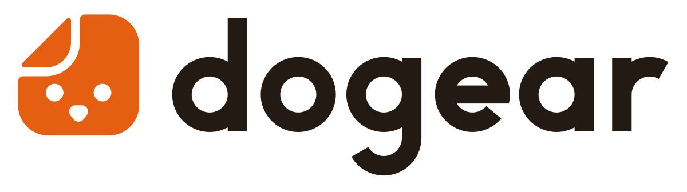

# Dogear



Mark where you stopped.

<!-- zuko:start — generated from OVERVIEW.md; edit that file, not this block -->

## What it does

Dogear is a Forge app for Jira. It keeps a dogear on each ticket: a short, current note of
where the work stands. A teammate who picks up the ticket carries on from it. An entry for
Codegeist 2026, which closes on 2026-12-22 at 12:00 Pacific Time.

## Install and run

| Task    | Command                                       |
| ------- | --------------------------------------------- |
| install | `npm install`                                 |
| run     | `npm run deploy`                              |
| test    | `npm test`, then `npm run e2e` after a deploy |
| lint    | `npm run lint`                                |

## Features

- A person saves a dogear on a Jira ticket, a short note that says where the work stands, and anyone who opens the ticket reads it.
- A coding agent such as Claude Code saves the dogear on a Jira ticket as it works, and a second agent reads it and carries on.
- A lead opens one page in a Jira project and sees each in-progress ticket that has no dogear, or a dogear that is behind the last work.
- A person opens a ticket with no dogear, selects one button, and gets a brief that AI builds from what Jira has.

## Docs

- [Overview](OVERVIEW.md)
- [Architecture](docs/ARCHITECTURE.md)
- [Decisions](DECISIONS.md)
- [Changelog](CHANGELOG.md)

<!-- zuko:end -->

## The at-risk list

Each Jira project gets a tab named Dogears. Jira may put it under More in the row of
tabs. It lists the in-progress tickets of the project that have no dogear, or a dogear
saved more than 1 hour before the last change of the ticket. Run `npm run e2e:setup` once
to make the project `SNR`, which the e2e test of this list uses.

## Connect a coding agent

A coding agent, such as Claude Code, reads and saves the dogear through two MCP
tools: `get-dogear` and `save-dogear`.

1. In Atlassian Administration, go to Apps, Sites, your site, Connected apps. Open
   Dogear and turn on "Expose tools to MCP-compatible apps".
2. Open the Dogear panel on a Jira ticket once, and select Allow access. The tools
   act as you, and they refuse to work until you do this.
3. Add the server to Claude Code. The app ID is the last part of `app.id` in
   `manifest.yml`:

   ```bash
   claude mcp add --transport http dogear https://mcp.atlassian.com/forge/<app-id>
   ```

4. Run `/mcp` in Claude Code, select `dogear`, and sign in.
5. Put this block in the `CLAUDE.md` or `AGENTS.md` of your code repo:

   ```markdown
   ## Dogear

   Each Jira ticket has a dogear: a short note with Done, Next, Watch out, Code. Keep it
   current with the `dogear` MCP tools.

   - Take the ticket key from the branch name: `feat/pay-142-refund` is PAY-142. If the
     branch has no key, ask me.
   - When you start work on a ticket, read its dogear first. Carry on from Next, and
     obey Watch out.
   - Save the dogear after each finished step, and before you stop.
   - Read the dogear before each save. A save replaces the whole dogear, so send each
     field that is still true.
   - Write for a teammate who did not see this session. Keep each field under 1,000
     characters.
   ```

In the development environment, each tool name ends in `_development`.

### e2e tests for the agent tools

`npm run e2e` also calls the tools through the MCP server, as the main account. Do steps
1 and 2 as the main account first. The tests sign notes with `NOTE_SIGNING_KEY` from
`.env`, which must be the same value as the Forge variable of that name:
`bash scripts/forge.sh variables set --encrypt -e development NOTE_SIGNING_KEY <value>`. Then run `npm run e2e:mcp-login` once, open the link
that it prints, and sign in as the main account. It saves the login in
`e2e/.auth/mcp.json`, which git ignores.
