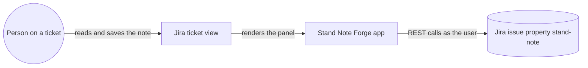
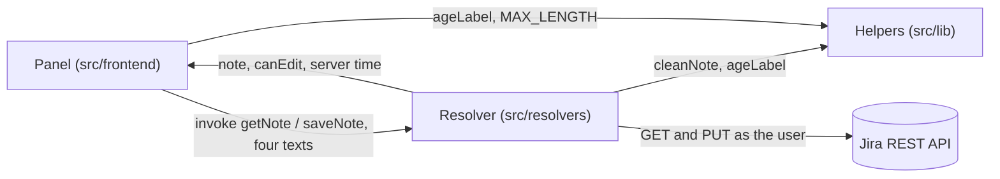

# CodegeistHackathon · architecture

**Status:** Active · **Updated:** 2026-11-21 by /ship stand-note

## Context

## Components

| Component | Folder           | What it does |
| --------- | ---------------- | ------------ |
| Panel     | `src/frontend/`  | The UI Kit panel on the ticket: the read view, the form and the two errors. |
| Resolver  | `src/resolvers/` | Reads and saves the note as the user, checks the edit permission, stamps the author and the time. |
| Helpers   | `src/lib/`       | `cleanNote` trims and caps the four texts; `ageLabel` gives the age of a note. |
