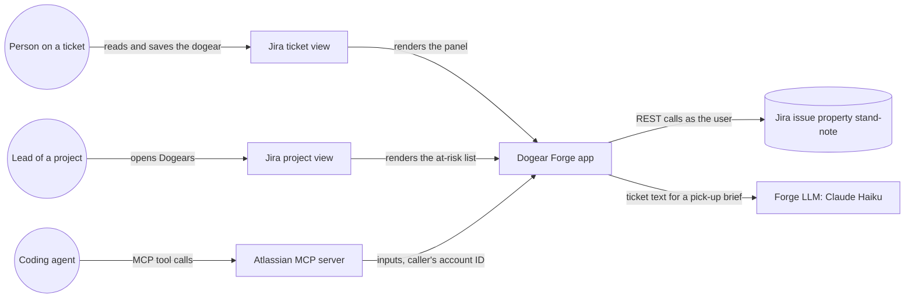
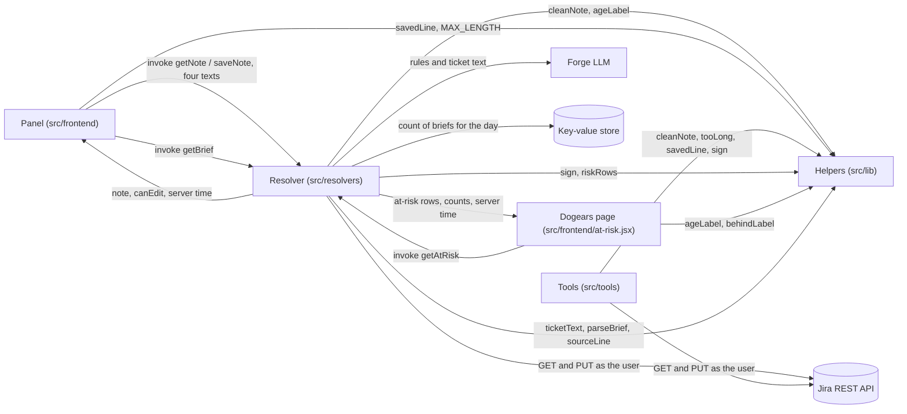

# Dogear · architecture

**Status:** Active · **Updated:** 2026-11-23 by /ship pick-up-brief

## Context

## Components

| Component | Folder           | What it does |
| --------- | ---------------- | ------------ |
| Panel     | `src/frontend/`  | The UI Kit panel on the ticket: the read view, the form and the two errors. On a ticket with no dogear, the button and the view of the pick-up brief (`BriefView.jsx`). |
| Page      | `src/frontend/at-risk.jsx` | The UI Kit project page Dogears: the in-progress tickets with no dogear or a dogear that is behind. |
| Resolver  | `src/resolvers/` | Reads and saves the dogear as the user, checks the edit permission, stamps the author and the time. `getAtRisk` searches the in-progress tickets of the project with their notes. `getBrief` reads a ticket through REST v2, asks Forge LLM for the pick-up brief, and counts the briefs of the site for each UTC day, 50 at most. |
| Tools     | `src/tools/`     | The two MCP tools of the agent, `get-dogear` and `save-dogear`. Each answers in one plain text and never throws. |
| Helpers   | `src/lib/`       | `cleanNote` trims and caps the four texts; `tooLong` names a field over the limit; `ageLabel` and `savedLine` give the age and the saved line; `sign` and `isSigned` sign a note with the Forge variable `NOTE_SIGNING_KEY` (server only); `riskRows` picks and orders the tickets at risk, and `behindLabel` says how far a note is behind; `ticketText`, `parseBrief` and `sourceLine` (`brief.js`) give the model's input, check its answer and count the sources of a brief. |
