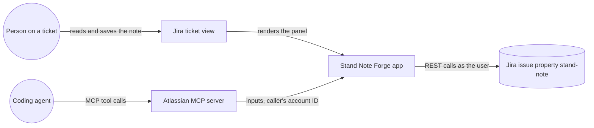
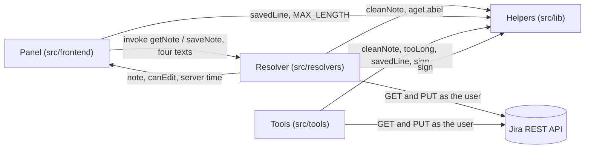

# CodegeistHackathon · architecture

**Status:** Active · **Updated:** 2026-11-21 by /ship agent-checkpoint

## Context

## Components

| Component | Folder           | What it does |
| --------- | ---------------- | ------------ |
| Panel     | `src/frontend/`  | The UI Kit panel on the ticket: the read view, the form and the two errors. |
| Resolver  | `src/resolvers/` | Reads and saves the note as the user, checks the edit permission, stamps the author and the time. |
| Tools     | `src/tools/`     | The two MCP tools of the agent, `get-stand-note` and `save-stand-note`. Each answers in one plain text and never throws. |
| Helpers   | `src/lib/`       | `cleanNote` trims and caps the four texts; `tooLong` names a field over the limit; `ageLabel` and `savedLine` give the age and the saved line; `sign` and `isSigned` sign a note with the Forge variable `NOTE_SIGNING_KEY` (server only). |
