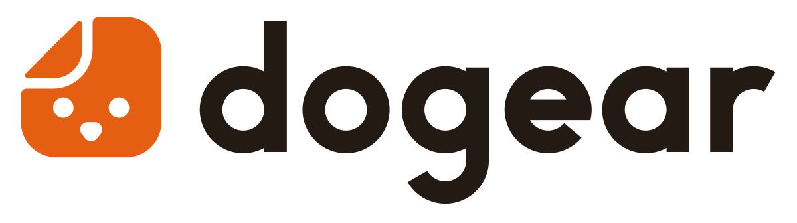

# Dogear logo guidelines

## The mark

A page with a face. Its folded corner is the ear. The dog-ear of the page is the dog's ear.

The name in the logo is drawn in lower case: "dogear". In a sentence, write "Dogear".

Tagline: "Mark where you stopped."

## Files

SVG files are in `svg/`, and PNG files are in `png/`.

| File | Use |
| ---- | --- |
| `dogear-logo-horizontal` | The main logo: symbol and name in one line. README header, title card. |
| `dogear-logo-stacked` | Symbol above the name. Square and tall spaces. |
| `dogear-symbol` | The symbol alone, from 32 px up. |
| `dogear-symbol-small` | The symbol for 16 to 24 px: larger eyes and a wider fold line. The panel and the tab in Jira. |
| `dogear-wordmark` | The name alone. |
| `dogear-app-icon-light`, `dogear-app-icon-dark` | A square tile for the app's avatar. Light is for light screens, dark is for dark screens. |
| `devpost-thumbnail.png` | The thumbnail for the Devpost entry, 1500 x 1000 px (3:2). |

Each logo has four colour versions:

| Suffix | Colours | Use on |
| ------ | ------- | ------ |
| none | Ginger symbol, Ink name | White and Paper |
| `-on-dark` | Ginger symbol, Paper name | Ink and other dark colours |
| `-black` | All black | One-colour print |
| `-white` | All white | A photo or a strong colour |

`board/` has two sheets that show the logo in use.

`svg/devpost-thumbnail.svg` is the source of the thumbnail. Its tagline is live text, so it
needs Montserrat on the machine that renders it. Each other SVG is shapes only.

## Clear space and size

Keep a clear zone around the logo, as wide as the letter "o" in the name. Around the symbol
alone, keep a quarter of its width.

| Version | Smallest size |
| ------- | ------------- |
| Horizontal logo | 96 px wide |
| Stacked logo | 72 px wide |
| Symbol | 16 px. Use `dogear-symbol-small` up to 24 px. |

## Colours

| Name | HEX | RGB | Use |
| ---- | --- | --- | --- |
| Ginger | `#E55F12` | 229, 95, 18 | The symbol. One accent, and no second accent. |
| Ink | `#231A14` | 35, 26, 20 | The name, text, dark backgrounds |
| Paper | `#FFF6EA` | 255, 246, 234 | Light backgrounds |

Contrast of Ginger: 3.5 to 1 on white, 3.3 to 1 on Paper, 4.6 to 1 on Jira's dark grey
`#1D2125`, and 4.9 to 1 on Ink. That is enough for the symbol. It is not enough for small
text, so do not set text in Ginger on a light background. Ink on Paper is 16 to 1.

These are screen colours. The kit has no print values.

## Typeface

The name in the logo is drawn from shapes. It is not a font, so do not type it.

For other text, use Montserrat: SemiBold for headings and for the tagline, Regular for text.
Montserrat is free under the SIL Open Font License 1.1. If it is not there, use the system's
sans-serif font.

## The name beside Jira

From "Atlassian brand guidelines for Marketplace Partners", read on 2026-11-23:
https://developer.atlassian.com/platform/marketplace/atlassian-brand-guidelines-for-marketplace-vendors/

- The app's name is "Dogear". When the product must be named, write "Dogear for Jira".
- Do not write "Jira Dogear" or "Dogear Jira". Atlassian's name does not go first, and it
  needs a preposition.
- Write "Jira", not "JIRA".
- Keep the words "Atlassian", "plugin", "add-on", "app", "beta" and "Premium" out of the name.
- The logo and the icon use no Atlassian logo, wordmark, font, icon or brand colour. Do not
  put the Jira logo beside the Dogear logo in one image.
- Say plainly that Dogear is a third-party app, not made by Atlassian.

Not checked: Atlassian's trademark page, https://www.atlassian.com/legal/trademark, may ask
for a trademark line. The page did not load as text.

## Do not

- Stretch, rotate or recolour the logo.
- Add a shadow, an outline or a gradient.
- Move or resize the symbol against the name.
- Put the colour logo on a busy photo. Use the white version, or an app-icon tile.

## Not checked

Nobody ran a trademark search on the symbol. The check of the name is in
`docs/specs/dogear-brand.md`, O4.
