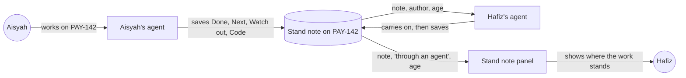
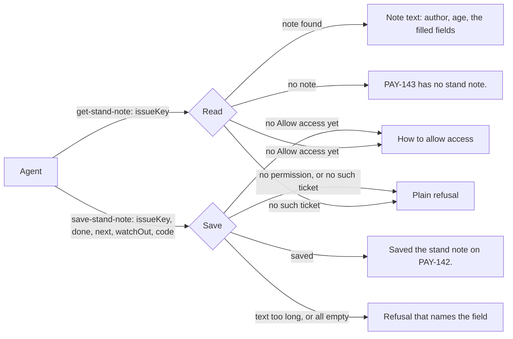

# Agent checkpoint

**Version:** v1 · **Status:** Draft · **Type:** Feature · **Project type:** Web UI

**Shape doc:** docs/specs/ticket-handover/shape.md
**Depends on:** stand-note

A coding agent such as Claude Code saves the stand note on a Jira ticket as it works, and
a second agent reads the note and carries on. It ships now because it removes the reason
notes go missing, and it qualifies the entry for the Atlassian MCP bonus prize (D1).

## Problem

The stand note from `stand-note` is only as current as the last time a person stopped to
write it. A developer who works with a coding agent does not stop: the agent holds the
state of the work, and the state leaves when the session ends. The teammate who picks up
the ticket, or their agent, then starts from the ticket text alone.

## Slice test

| Check                         | Result |
| ----------------------------- | ------ |
| Cuts every layer it needs     | yes — two MCP tools, the note on the ticket, the saved line in the panel, deployed on Forge |
| One e2e test walks it         | yes — an agent saves through MCP, the panel shows the note, a second read through MCP returns it. The sign-in of the test is O8. |
| Worth shipping alone          | yes — a team with coding agents gets current notes with no hand work |
| Fits (≤5 scenarios, ≤2 areas) | yes — 5 scenarios, two areas: the MCP tools and the saved line of the panel |

**Path:** full — a new interface for agents, and a new field in the stored note.

## User story

As a developer who works with a coding agent, I want the agent to keep the stand note
current, so that a teammate or their agent carries on without a message to me.

## Flow



Aisyah's agent saves the note on PAY-142 as it works, Hafiz's agent reads the note and
carries on, and the panel shows each person that an agent saved it.

## Acceptance criteria

```gherkin
Scenario: An agent saves the note
  Given Aisyah Rahman can edit PAY-142 "Add refund endpoint"
  And Aisyah selected Allow access in the Stand note panel before
  And her agent wrote the endpoint and the validation on branch feat/pay-142-refund
  When the agent saves a stand note on PAY-142
  And the note has Done "Endpoint and validation are written"
  And the note has Next "Add the idempotency check"
  And the note has Watch out "The sandbox rejects amounts over RM 5,000"
  And the note has Code "feat/pay-142-refund"
  Then the agent gets "Saved the stand note on PAY-142."
  When Hafiz Omar opens PAY-142 and expands Stand note
  Then the panel shows the four fields as the agent sent them
  And the panel says "Saved by Aisyah Rahman through an agent, just now"

Scenario: A second agent reads the note and carries on
  Given Aisyah's agent saved the stand note on PAY-142 on 2026-11-24 at 16:40
  And Aisyah is on sick leave on 2026-11-26
  When Hafiz's agent reads the stand note of PAY-142 on 2026-11-26 at 09:15
  Then the agent gets Done, Next, Watch out and Code as Aisyah's agent saved them
  And the agent gets "Saved by Aisyah Rahman through an agent, 2 days ago"
  When Hafiz's agent adds the idempotency check
  And it saves a note with Done "Endpoint, validation and idempotency check are written"
  And the note has Next "Write the tests for partial refunds"
  Then the panel on PAY-142 says "Saved by Hafiz Omar through an agent, just now"
  And the panel shows Hafiz's Done and Next
  And Watch out and Code are empty, because the agent did not send them

Scenario: An agent reads a ticket with no note
  Given ticket PAY-143 "Add refund report" has no stand note
  And Hafiz Omar can view PAY-143
  When Hafiz's agent reads the stand note of PAY-143
  Then the agent gets "PAY-143 has no stand note."

Scenario: The app refuses a text that is too long
  Given PAY-142 has the stand note that Aisyah's agent saved
  When Hafiz's agent saves a note with a Done text of 1,240 characters
  Then the agent gets "Done has 1,240 characters. The limit is 1,000."
  And the note on PAY-142 is the same as before

Scenario: The person did not allow access yet
  Given Tan Mei Ling can edit PAY-142
  And Mei Ling never opened the Stand note panel
  When Mei Ling's agent saves a stand note on PAY-142
  Then the agent gets "Open the Stand note panel on a Jira ticket once and select Allow access. Then save again."
  And the note on PAY-142 is the same as before
  When Mei Ling opens PAY-142, expands Stand note and selects Allow access
  And her agent saves the note again
  Then the panel says "Saved by Tan Mei Ling through an agent, just now"
```

## Scope

**In:**

- Two tools for an agent on the Atlassian MCP server: one saves the stand note of a
  ticket, and one reads it. The agent gives the ticket key.
- The save takes the four texts and replaces the whole note. A field that the agent does
  not send is empty after the save (O3).
- The limits of `stand-note` apply: 1,000 characters for each field, and text in one or
  more fields. The app refuses a longer text and names the field (O4). The app also
  refuses a note with four empty fields.
- The read gives the four texts, the author, the age, and "through an agent" when an
  agent saved the note. A ticket with no note gives "PAY-143 has no stand note."
- The tools act as the person who signed in. A person who can edit the ticket can save
  through an agent. A person who can view the ticket can read through an agent.
- A person with no permission gets a refusal in plain words, and the note stays as it is.
- A person who did not allow access in the panel gets the refusal of scenario 5, for the
  save and for the read (O5).
- The saved line of the panel says "through an agent" when the last save came through
  the tool (O2). A save in the panel removes those words.
- The later save wins, with no warning, also when a person changed the note between the
  agent's read and the agent's save (O7).
- A rule text for `CLAUDE.md` or `AGENTS.md`, in the README (O6). It tells the agent to
  read the note when work on a ticket starts. It tells the agent to save after each
  finished step and before the session stops. It tells the agent to take the ticket key
  from the branch name, or to ask.
- The setup steps for the developer site, in the README: the admin switch and the
  `claude mcp add` command.
- The app runs on the developer Jira site, in the Forge development environment.
- Vitest unit tests, and one e2e test that walks the slice.

**Out:**

- A hook that reminds the agent to save when a session ends — no slice yet.
- A refusal of a save over a note that changed since the agent's read — no slice yet.
- The agent's own name in the saved line, such as "through Claude Code" — no slice yet.
- A test of other agents, such as Cursor or a Rovo agent — no slice yet. The tools are
  standard MCP tools, and this slice tests Claude Code only.
- A list of tickets with a stale note — `at-risk-list`.
- A production deploy, the install link, and the setup guide for judges with the admin
  switch — `judge-ready-entry`.
- The history of earlier notes — no slice yet.

## Interface

This slice has two interfaces. The main one is for an agent: two MCP tools. The other is
one changed line in the Stand note panel.



The agent calls one tool to read and one to save, and each call ends in one plain text:
the note, a confirmation, or a refusal that says what to do.

### The MCP server

- Name in the manifest: `Stand Note`.
- Name in Claude Code: `stand-note`, from `claude mcp add --transport http stand-note <url>`.
- In the development environment, each tool name ends in `_development`.

### Tool: `get-stand-note`

Description, as the agent sees it:

> Reads the stand note of a Jira ticket: what is done, what is next, what to watch out
> for, and where the code is. Call it when work on a ticket starts, and before each save.

| Input      | Type   | Required | Description |
| ---------- | ------ | -------- | ----------- |
| `issueKey` | string | yes      | The Jira ticket key, such as PAY-142. |

The reply is plain text. It has only the fields that hold text:

```
Stand note on PAY-142
Saved by Aisyah Rahman through an agent, 2 days ago
Done: Endpoint and validation are written
Next: Add the idempotency check
Watch out: The sandbox rejects amounts over RM 5,000
Code: feat/pay-142-refund
```

When a person saved the note in the panel, the second line is `Saved by Hafiz Omar, 2 days ago`.

### Tool: `save-stand-note`

Description, as the agent sees it:

> Saves the stand note of a Jira ticket, so that a teammate or their agent can carry on.
> The save replaces the whole note: send each field that is still true. Call it after
> each finished step, and before the session stops.

| Input      | Type   | Required | Description |
| ---------- | ------ | -------- | ----------- |
| `issueKey` | string | yes      | The Jira ticket key, such as PAY-142. |
| `done`     | string | no       | What is finished. 1,000 characters at most. |
| `next`     | string | no       | The next step. 1,000 characters at most. |
| `watchOut` | string | no       | Traps, and what you tried that failed. 1,000 characters at most. |
| `code`     | string | no       | The branch name, or a link to the code. 1,000 characters at most. |

The reply is `Saved the stand note on PAY-142.`

### Refusals

Each refusal is one plain text, and the note on the ticket stays as it was.

| Case | Tool | Reply |
| ---- | ---- | ----- |
| A field has more than 1,000 characters | save | `Done has 1,240 characters. The limit is 1,000.` One sentence pair for each long field. |
| All four fields are empty | save | `A stand note needs text in Done, Next, Watch out or Code.` |
| The person did not allow access yet | save | `Open the Stand note panel on a Jira ticket once and select Allow access. Then save again.` |
| The person did not allow access yet | read | `Open the Stand note panel on a Jira ticket once and select Allow access. Then read again.` |
| The person cannot edit the ticket | save | `You cannot edit PAY-142, so the note was not saved.` |
| Jira has no such ticket, or the person cannot view it | both | `Jira has no ticket PAY-999 that you can see.` |
| Jira fails for another reason | both | `Jira did not answer the save. The note was not saved. Try again.` For the read: `Jira did not answer the read. Try again.` |

### The rule text

The README gives this block for a repo's `CLAUDE.md` or `AGENTS.md`:

```markdown
## Stand note

Each Jira ticket has a stand note: Done, Next, Watch out, Code. Keep it current with
the `stand-note` MCP tools.

- Take the ticket key from the branch name: `feat/pay-142-refund` is PAY-142. If the
  branch has no key, ask me.
- When you start work on a ticket, read its stand note first. Carry on from Next, and
  obey Watch out.
- Save the stand note after each finished step, and before you stop.
- Read the note before each save. A save replaces the whole note, so send each field
  that is still true.
- Write for a teammate who did not see this session. Keep each field under 1,000
  characters.
```

### The panel: the saved line

```
v Stand note   Where the work stands
  Done
  Endpoint and validation are written
  Next
  Add the idempotency check
  Watch out
  The sandbox rejects amounts over RM 5,000
  Code
  feat/pay-142-refund
  Saved by Aisyah Rahman through an agent, 2 days ago
  [ Edit ]
```

- The words `through an agent` show only when the last save came through the tool.
- The line stays one plain text, in the same small grey style as today. No icon, no tag.
- Each other state of the panel is the same as in `stand-note`.

**Design system:** Forge UI Kit (D3). The slice adds no component and no token.

**Motion tier:** 0. UI Kit gives the app no control of motion.

**Components used:** Text, which holds the saved line today.

**Preview:** the wireframe above. UI Kit renders only inside Jira, so the build shows the real
line on `dzaffren.atlassian.net`.

**Reference:** Atlassian's own MCP tools, such as `getJiraIssue`: a verb first, and the ticket
key as the first input. For the refusals, Stripe's API errors: each one says what is wrong and
what to do next.

**The two craft checks.** A one-line prompt gives one tool that takes a free text. These tools
take the four handover fields, refuse a long text in place of a silent cut, and tell the agent
how to get past the consent step. Next to `getJiraIssue`, the inputs are as short, and the
replies are shorter, because an agent pays for each word it reads.

## Spike findings, 2026-11-21

A throwaway Forge app answered O1. The spike code is deleted, and the app is uninstalled.

- The manifest needs one `rovo:mcp` module that lists action keys, one `action` for each tool
  with `actionVerb` and `inputs`, and one `function` for each action.
- The function gets `(payload, context)`. The payload holds the inputs. The caller's account ID
  is in `context.principal.accountId`.
- The string that the function returns comes back to the agent as the tool result.
- Outside access is off by default. The switch is "Expose tools to MCP-compatible apps", on the
  app's page under Connected apps in Atlassian Administration. It is set for each site.
- `claude mcp add --transport http <name> https://mcp.atlassian.com/forge/<appId>`, then `/mcp`,
  connects Claude Code. The person signs in on Atlassian's OAuth screen.
- In the development environment, the tool name ends in `_development`: the action
  `save-probe` showed in Claude Code as `save-probe_development`.
- `asUser()` threw "Authentication Required" on the first call. The OAuth screen of the MCP
  sign-in does not count as consent. After the person selected "Allow access" in a panel of
  the same app, `asUser()` read `/myself` as the person and wrote the property.
- `asApp()` wrote the property with no consent. Jira then sees the app as the writer.
- The docs say Rovo must be active on the site. The spike did not check if the site needs it.

## Open items

| ID  | What | Type | Raised at | Owner | Status | Answer |
| --- | ---- | ---- | --------- | ----- | ------ | ------ |
| O1  | An outside agent such as Claude Code can call this app's tools through the Atlassian MCP server and save a note on a ticket. The `rovo:mcp` module is in Preview. The Forge docs say a site admin turns on outside access, and the endpoint is `https://mcp.atlassian.com/forge/<appId>`. One community post says the Preview serves only Rovo agents. (from shape O5) | unproven | shape | poc | Resolved | Yes, with a condition. A throwaway app with one `rovo:mcp` tool was called from Claude Code through `https://mcp.atlassian.com/forge/<appId>`, and the tool wrote an issue property on PAY-1. The tool gets the caller's account ID in `principal.accountId`. A site admin first turns on "Expose tools to MCP-compatible apps" for the app. The condition: `asUser()` fails with "Authentication Required" until the person selects "Allow access" in a panel of the same app. After that, `asUser()` wrote the property with status 201. `asApp()` works with no consent. The fallback through the built-in tools is not needed. Recorded as D12. The spike took 18 of 60 minutes, and its code is deleted. 2026-11-21 |
| O2  | What does the saved line say when an agent saved the note? | question | spec p1 | user | Resolved | "Saved by Aisyah Rahman through an agent, just now". The app knows that the save came through the MCP tool. It does not take the agent's name on the agent's word. 2026-11-21 |
| O3  | An agent sends some of the four fields. What happens to the fields that it does not send? | question | spec p1 | user | Resolved | The save replaces the whole note, as in the panel. A field that the agent does not send is empty after the save. 2026-11-21 |
| O4  | An agent sends a field of more than 1,000 characters. | question | spec p1 | user | Resolved | The app refuses the save and names the field: "Done has 1,240 characters. The limit is 1,000." Nothing is saved. 2026-11-21 |
| O5  | A person never opened the Stand note panel, so the app has no consent to act as them. Their agent saves a note. | question | spec p1 | user | Resolved | The app refuses and says how to fix it: "Open the Stand note panel on a Jira ticket once and select Allow access. Then save again." The app does not save as itself, so Jira's own permissions stay in charge (D4). 2026-11-21 |
| O6  | The app cannot make an agent save. What ships so that the agent saves and reads the note without a request each time? | question | spec p1 | user | Resolved | A rule text for `CLAUDE.md` or `AGENTS.md`, in the README. No hook. 2026-11-21 |
| O7  | A person changes the note in the panel between an agent's read and the agent's save. | question | spec p1 | user | Resolved | The later save wins, with no warning, as in the panel. The rule text tells the agent to read the note before each save. 2026-11-21 |
| O8  | An e2e test script can sign in to `https://mcp.atlassian.com/forge/<appId>` with a saved login and call the save tool, with no person at the OAuth screen. | unproven | spec p1 | user | Accepted risk | The build tries the saved login first. If it fails, a person walks the MCP save in Claude Code, and Playwright still checks the panel after it. The unit tests cover the tool function. Accepted 2026-11-21 |
| O9  | The Forge docs say Rovo must be active on the site for a `rovo:mcp` module. The tools worked on `dzaffren.atlassian.net`, and nobody checked a site with no Rovo. A judge's site may have none. | flag | spec p1 | user | Accepted risk | This slice runs only on the developer site, where the tools work. `judge-ready-entry` tests a clean site and writes the setup guide from the result. Accepted 2026-11-21 |

_Never delete this section or its rows. See references/ledger.md._

## Glossary

- **Forge** — Atlassian's platform for apps that run inside Jira and its other products.
- **MCP** — Model Context Protocol, the standard way an AI agent calls outside tools.
- **Atlassian MCP server** — the server that gives an agent tools for Jira and other Atlassian products.
- **`rovo:mcp`** — the Forge module that publishes an app's own tools on the Atlassian MCP server.
- **Rovo** — Atlassian's AI assistant and agents inside its products.
- **Preview** — a feature released for trial; its behaviour can change.
- **Coding agent** — an AI tool that writes code for a developer, such as Claude Code.
- **Stand note** — the short note on a ticket that says where the work stands: done, next, watch out.
- **Jira issue property** — a small piece of data that an app attaches to one ticket.
- **Consent** — Atlassian's record that a person let an app act as them. A person gives it with "Allow access".
- **OAuth** — the sign-in screen where a person lets a tool reach their account.
- **`asUser()`** — a Jira call that the app makes as the person, so Jira's permissions for that person apply.
- **`asApp()`** — a Jira call that the app makes as itself.
- **`CLAUDE.md`, `AGENTS.md`** — files in a code repo that hold standing rules for a coding agent.
- **Hook** — a command that Claude Code runs by itself at a set moment, such as the end of a session.
- **Module** — one place where a Forge app adds something to Jira, such as a panel or a set of tools.
- **Development environment** — the Forge copy of the app for work in progress.
- **e2e** — end to end. An e2e test uses the app as a user does.
- **Vitest** — a tool that runs unit tests for JavaScript.
- **Playwright** — a tool that drives a real browser from a test.
- **`/poc`** — a short spike with throwaway code that answers one risky question.
- **Idempotency check** — a check that stops the same request from being done twice. It is example text in a scenario.
- **D1, D4, D12** — entries in `DECISIONS.md`.
