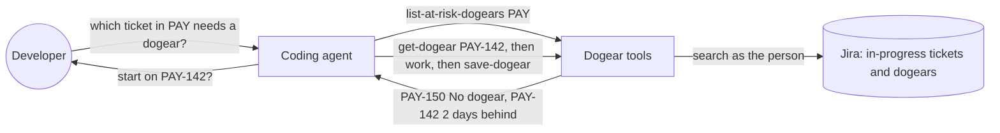
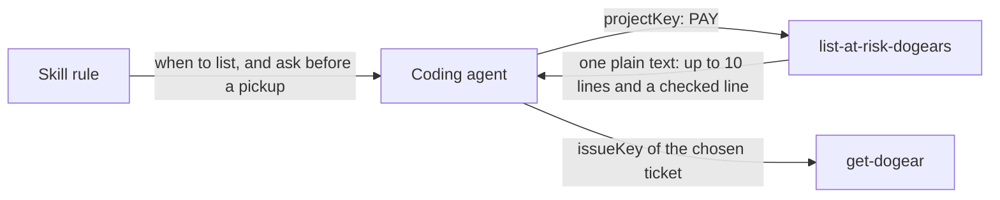

# Agent pickup

**Version:** v1 · **Status:** Draft · **Type:** Feature · **Project type:** Web UI

**Shape doc:** docs/specs/ticket-handover/shape.md
**Depends on:** agent-checkpoint, at-risk-list, judge-ready-entry

A coding agent asks Dogear which tickets of a project have no dogear, or one that is
behind the work, and then picks one up from its dogear. It ships before `submit-entry`
because the video needs the one thing that a rule telling the agent to comment cannot do.

## Problem

The agent's two tools read and save the dogear of a ticket that the person already knows.
The at-risk list finds the tickets whose handover is missing or out of date, but only a
person in Jira sees it. An agent cannot ask "which ticket in PAY needs me?", so the two
parts of Dogear that no other tool has stay apart.

A judge of Codegeist 2026 scored innovation 3 of 5 on 2026-11-24: "only the at-risk tab
clearly gets past" a rule that tells the agent to post comments. Jira's "Summarize work
item" already summarizes a ticket on demand. Nothing that we found tells an agent which
handovers are stale.

## Slice test

| Check                         | Result |
| ----------------------------- | ------ |
| Cuts every layer it needs     | yes — a manifest action and function, the tool over Jira search, the skill file and the guide |
| One e2e test walks it         | yes — through the MCP server: list, read the top ticket, save, list again |
| Worth shipping alone          | yes — a developer asks their agent which handovers in a project are stale, and the agent carries one on |
| Fits (≤5 scenarios, ≤2 areas) | yes — 5 scenarios; the agent's tools, and the skill file with the guide |

**Path:** full — a new MCP tool is a new interface.

## User story

As a developer with a coding agent, I want to ask the agent which tickets of a project
have a missing or stale dogear, so that it picks one up from where the work stopped.

## Flow



The developer asks, the agent lists the stale handovers, asks which one to take, reads its
dogear, carries on, and saves. A save takes the ticket off the list.

## Acceptance criteria

```gherkin
Scenario: The agent lists the tickets that need a dogear
  Given project PAY has three in-progress tickets:
    | PAY-150 | Add partial refunds | Hafiz Omar    | no dogear                                    |
    | PAY-142 | Add refund endpoint | Aisyah Rahman | a dogear saved 2 days before its last change |
    | PAY-161 | Refund webhooks     | Mei Ling Tan  | a dogear saved after its last change         |
  When the agent calls list-at-risk-dogears with project PAY
  Then the answer lists PAY-150 with "No dogear" first, then PAY-142 with "Dogear is 2 days behind"
  And each line has the ticket's summary and assignee
  And PAY-161 is not in the answer
  And the answer ends "Checked 3 in-progress tickets in PAY."

Scenario: A save takes the ticket off the list
  Given PAY-142 is on the list with "Dogear is 2 days behind"
  When the agent reads the dogear of PAY-142 and saves a new one
  Then the next list of PAY does not have PAY-142

Scenario: No ticket needs a dogear
  Given each in-progress ticket in PAY has a dogear saved after its last change
  When the agent calls list-at-risk-dogears with project PAY
  Then the answer is "No in-progress ticket in PAY needs a dogear. Checked 3 in-progress tickets in PAY."

Scenario: A project that the person cannot see
  Given the person cannot browse project HR
  When the agent calls list-at-risk-dogears with project HR
  Then the answer is "Jira has no project HR that you can see."

Scenario: Many tickets need a dogear
  Given 14 in-progress tickets in PAY need a dogear
  When the agent calls list-at-risk-dogears with project PAY
  Then the answer lists 10 of them, in the order of the Dogears tab
  And then says "4 more need a dogear. Open the Dogears tab of PAY to see them all."
```

## Scope

**In:**

- The MCP tool `list-at-risk-dogears`, with the same rule and order as the Dogears tab (D17).
  It answers in one plain text and never throws, as the two other tools do.
- A rule in `skills/dogear/SKILL.md` and in the guide's AGENTS.md block: how the agent
  picks a ticket from the list.
- A third prompt in part 3 of `GUIDE.md` that calls the list.

**Out:**

- Assigning the ticket to the person. The built-in Atlassian MCP tools can do it.
- A pick-up brief for a ticket with no dogear, through the agent. The brief stays in the
  panel (D21); the agent reads the ticket itself.
- A list across all projects. The agent names one project.
- The video beat that shows this tool — `submit-entry`.

## Interface

The slice has no screen. Its interface is the tool that the agent calls, the texts that
the tool answers, and the rule in the skill file. The words are the Dogears tab's words.



### The tool

| Part | Value |
| ---- | ----- |
| Key and name | `list-at-risk-dogears` · List at-risk dogears |
| Verb | `GET` |
| Description | Lists the in-progress tickets of a Jira project that have no dogear, or a dogear saved more than 1 hour before the ticket last changed. Call it when the person asks which ticket to pick up. Then read the dogear of the ticket that they choose. |
| Input | `projectKey`, a string, required: "The Jira project key, such as PAY." |

### The answers

A list, with one line for each ticket. The order and the label are the Dogears tab's:
tickets with no dogear first, then the largest gap.

```text
Tickets in PAY that need a dogear:
- PAY-150 · Add partial refunds · Hafiz Omar · No dogear
- PAY-142 · Add refund endpoint · Aisyah Rahman · Dogear is 2 days behind
- PAY-175 · Add refund report · Unassigned · Dogear is 5 hours behind, saved outside Dogear
Checked 3 in-progress tickets in PAY.
```

| Case | Text |
| ---- | ---- |
| More than 10 at risk | After the 10th line: "4 more need a dogear. Open the Dogears tab of PAY to see them all." |
| More than 100 in progress | The last line: "Checked the 100 most recently updated of about 240 in-progress tickets in PAY." |
| None at risk | "No in-progress ticket in PAY needs a dogear. Checked 3 in-progress tickets in PAY." |
| None in progress | "No ticket in PAY is in progress. The list checks the tickets whose status is in progress." |
| No such project, or the person cannot see it | "Jira has no project HR that you can see." |
| Access not allowed in the panel | "Open the Dogear panel on a Jira ticket once and select Allow access. Then list again." |
| Jira fails | "Jira did not answer the search. Try again." |

One ticket reads "1 in-progress ticket", as on the tab.

### The skill rule

A sixth rule in `skills/dogear/SKILL.md` and in the guide's AGENTS.md block:

> When I ask which ticket to pick up, list the tickets of the project that need a dogear.
> Show me the list, and ask which one to start before you read its dogear.

### The guide

Part 3 of `GUIDE.md` gets a third prompt: "Which tickets in KAN need a dogear?" Claude Code
lists them and asks which one to start.

## Open items

| ID | What | Type | Raised at | Owner | Status | Answer |
| -- | ---- | ---- | --------- | ----- | ------ | ------ |
| O1 | What does the agent give the tool: a project key that it takes from the branch (PAY from `feat/pay-142-refund`), or nothing, with the tool guessing a project? | question | spec p1 | user | Resolved | A project key, required. The agent takes PAY from the branch `feat/pay-142-refund`, or asks the person. 2026-11-24 |
| O2 | How many tickets does one answer list? Each line costs the agent's context. The Dogears tab checks up to 100 tickets. | question | spec p1 | user | Resolved | 10 tickets, in the order of the Dogears tab, then a count of the rest that sends the person to the tab. 2026-11-24 |
| O3 | When the agent picks a ticket from the list, does it start on its own, or ask first? A listed ticket often has another person as its assignee. | question | spec p1 | user | Resolved | Ask first. The skill tells the agent to show the list and ask before it starts on a ticket. Drafted as an entry at pause 3. 2026-11-24 |
| O4 | Does the list carry each ticket's Next, or only the key, summary, assignee and how far behind? The Dogears tab keeps the note texts on the server (at-risk-list). | question | spec p1 | user | Resolved | No texts. Each line has the key, summary, assignee and how far behind, as on the Dogears tab. The agent calls `get-dogear` on the ticket it picks. Drafted as an entry at pause 3. 2026-11-24 |
| O5 | After part 2 of the guide, the judge's only ticket, KAN-1, has a current dogear, so the third prompt would answer "No in-progress ticket in KAN needs a dogear". How does the guide give the list a ticket to show? | question | spec p2 | user | Open | — |

## Glossary

- **MCP tool** — a function that a coding agent calls through the Atlassian MCP server.
- **At risk** — an in-progress ticket with no dogear, or a dogear saved more than 1 hour
  before the ticket last changed (D17).
- **Dogears tab** — the project page of Dogear that lists the tickets at risk.
- **e2e** — end to end. An e2e test uses the app as a user does.
