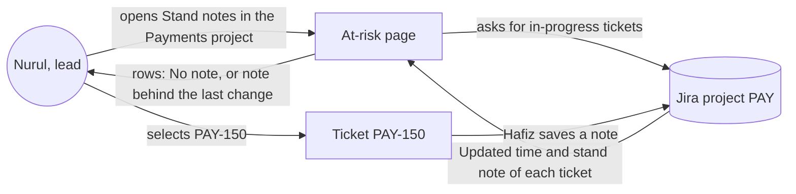
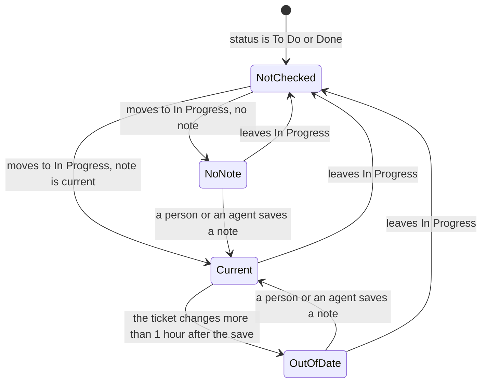
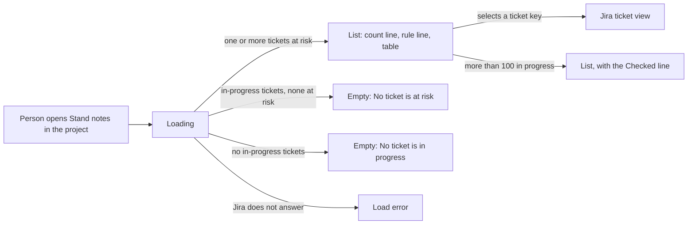

# At-risk list

**Version:** v1 · **Status:** Draft · **Type:** Feature · **Project type:** Web UI

**Shape doc:** docs/specs/ticket-handover/shape.md
**Depends on:** stand-note, agent-checkpoint

A lead opens one page in a Jira project and sees each in-progress ticket that has no
stand note, or a note that is behind the last work. It ships now because a rule that tells
an agent to comment cannot do this part, so it carries the innovation score.

## Problem

A stand note helps only when it is there and current. Today nobody knows which tickets
have no note until a teammate is out and someone opens the ticket. A lead who wants to
check must open each in-progress ticket and expand the panel, one ticket at a time.

## Slice test

| Check                         | Result |
| ----------------------------- | ------ |
| Cuts every layer it needs     | yes — a project page, a backend call, Jira search, the note on each ticket, deployed on Forge |
| One e2e test walks it         | yes — open the page, read the two at-risk rows, save a note on one ticket, see the row leave |
| Worth shipping alone          | yes — a lead finds the tickets that would hand over badly, before a teammate is out |
| Fits (≤5 scenarios, ≤2 areas) | yes — 5 scenarios, two areas: the new project page and its backend call |

**Path:** full — a new page, and a new read across many tickets.

## User story

As a lead of a Jira project, I want one list of the in-progress tickets with no current
stand note, so that I ask for a note before the person is out.

## Flow



Nurul opens the page in the Payments project, the page compares each in-progress ticket's
note with its last change, and she opens a ticket from a row.

## States



The page lists a ticket only in the states NoNote and OutOfDate.

## Acceptance criteria

```gherkin
Scenario: A lead sees the tickets at risk
  Given project Payments has these tickets on 2026-11-26 at 14:00
    | Key     | Summary                   | Status      | Assignee      | Note saved       | Updated          |
    | PAY-142 | Add refund endpoint       | In Progress | Aisyah Rahman | 2026-11-24 16:40 | 2026-11-26 09:10 |
    | PAY-150 | Add partial refunds       | In Progress | Hafiz Omar    | none             | 2026-11-26 11:00 |
    | PAY-151 | Fix the settlement report | In Review   | Aisyah Rahman | 2026-11-26 10:00 | 2026-11-26 10:20 |
    | PAY-155 | Add webhook retries       | To Do       | Hafiz Omar    | none             | 2026-11-25 15:00 |
    | PAY-139 | Rotate the sandbox keys   | Done        | Hafiz Omar    | none             | 2026-11-20 12:00 |
  And Nurul Huda can view project Payments
  When Nurul opens Stand notes in the Payments project
  Then the page says "2 of 3 in-progress tickets are at risk"
  And the first row shows PAY-150, "Add partial refunds", Hafiz Omar and "No note"
  And the second row shows PAY-142, "Add refund endpoint", Aisyah Rahman and "Note is 2 days behind"
  And the page has no row for PAY-151, PAY-155 or PAY-139

Scenario: A saved note takes the ticket off the list
  Given the page shows PAY-150 with "No note"
  When Nurul selects PAY-150 in the row
  Then Jira opens ticket PAY-150
  When Hafiz Omar saves a stand note on PAY-150
  And Nurul opens Stand notes in the Payments project again
  Then the page says "1 of 3 in-progress tickets are at risk"
  And the page has no row for PAY-150

Scenario: No ticket is at risk
  Given each in-progress ticket in project Payments has a stand note
  And no ticket changed more than 1 hour after its note was saved
  When Nurul opens Stand notes in the Payments project
  Then the page says "No ticket is at risk"
  And the page says "Each of the 3 in-progress tickets has a current stand note."

Scenario: The project has more than 100 in-progress tickets
  Given project Operations has 240 in-progress tickets
  And 37 of the 100 most recently updated tickets are at risk
  When Nurul opens Stand notes in the Operations project
  Then the page says "37 of 100 in-progress tickets are at risk"
  And the page says "Checked the 100 most recently updated of 240 in-progress tickets."

Scenario: The list does not load
  Given Nurul can view project Payments
  When she opens Stand notes in the Payments project and Jira does not answer
  Then the page says "The list did not load. Reload the page."
  And the page shows no rows and no count
```

## Scope

**In:**

- A page named Stand notes in the row of tabs of each Jira project. It lists the tickets of
  that project only.
- The page checks each ticket whose status is in Jira's In Progress category. In Review
  counts, because Jira puts it in that category.
- A ticket is at risk when it has no stand note.
- A ticket is also at risk when Jira's Updated time is more than 1 hour after the note's
  saved time. Any change that Jira records counts: a comment, a field edit, a status move.
- Each row shows the ticket key, the summary, the assignee and the reason. The key opens
  the ticket. A ticket with no assignee shows "Unassigned".
- The reason is "No note", or how far the note is behind: "Note is 3 hours behind",
  "Note is 2 days behind".
- The order: tickets with no note first, the oldest Updated time on top. Then the notes
  that are behind, the largest gap on top.
- A count line above the rows, as in the scenarios.
- The page checks 100 tickets at most: the 100 most recently updated. It says so when the
  project has more.
- A note that Stand Note did not sign counts by its saved time. Its row also says
  "saved outside Stand Note".
- Anyone who can view the project can open the page. Jira's own permissions hide each
  ticket that the person cannot view.
- The page loads the list once for each visit. A reload gets the new list.

**Out:**

- A warning in the Stand note panel that the note is behind — a new slice,
  `stale-note-warning`, after this one.
- Tickets from more than one project in one list — no slice yet.
- More than 100 tickets, with pages — no slice yet.
- A message to the assignee from the list — no slice yet.
- Filters, such as by assignee — no slice yet.
- A setting for the grace time or for the statuses — no slice yet.
- A scheduled report by email or chat — no slice yet.
- A production deploy and the install link for judges — `judge-ready-entry`.

## Interface

**Design system:** Forge UI Kit, as in `stand-note` (D3). The page adds no tokens and no
components of its own. UI Kit follows the Jira theme, light or dark.

**Motion tier:** 0. UI Kit gives the app no control of motion. The spinner is Atlassian's.

**Reference:** Jira's own work list, for one dense row for each ticket with the key as the
link. From Linear: colour only where it means something. Here the two lozenge colours are
the only colour on the page.

**Preview:** the wireframes below. UI Kit renders only inside Jira, so an HTML copy would
not show the real components. The build shows the real page on `dzaffren.atlassian.net`.



A person opens the page, waits for one load, and gets the list, one of two empty views, or
the load error. A ticket key opens the ticket.

### Where the page is

- Module title: `Stand notes`. Jira shows it at the top of the page.
- The Forge docs say that a project page shows in the row of tabs of the project, next to
  Board and List. The build confirms the spot on the site (O11).

### List

```
Stand notes

2 of 3 in-progress tickets are at risk
A ticket is at risk when it has no stand note, or when it changed more than 1 hour
after its note was saved.

Ticket                          Assignee        Stand note                  Last change
PAY-150  Add partial refunds    Hafiz Omar      [ No note ]                 3 hours ago
PAY-142  Add refund endpoint    Aisyah Rahman   [ Note is 2 days behind ]   4 hours ago
PAY-147  Add refund webhooks    Unassigned      [ Note is 5 hours behind ]  20 min ago
                                                saved outside Stand Note
```

- The count line is a heading. The rule line under it is small, subtle text.
- Ticket: the key is a link that opens the ticket in the same tab. The summary is plain text.
- Assignee: the display name as plain text, or `Unassigned`.
- Stand note: a lozenge. `No note` is red. `Note is 2 days behind` is yellow.
- A note that Stand Note did not sign gets a second, small line: `saved outside Stand Note`.
- Last change: the age of Jira's Updated time, in the words of the panel: `20 min ago`,
  `3 hours ago`, `2 days ago`.
- The rows are in the order of O5. A person cannot sort the columns.
- All rows are on one page, 100 at most. The table has no pager.

### The Checked line

```
37 of 100 in-progress tickets are at risk
A ticket is at risk when it has no stand note, or when it changed more than 1 hour
after its note was saved.
Checked the 100 most recently updated of 240 in-progress tickets.
```

The line shows only when the project has more than 100 in-progress tickets.

### The two empty views

```
            No ticket is at risk
   Each of the 3 in-progress tickets has a current stand note.

            No ticket is in progress
   The list checks the tickets whose status is in progress.
```

Each view takes the place of the count line, the rule line and the table.

### Loading and the load error

```
  (spinner)                                    label: Loading the at-risk list

  (!) The list did not load. Reload the page.  in place of the page content
```

**Components used:** Stack, Inline, Heading, Text, DynamicTable, Link, Lozenge, EmptyState,
SectionMessage, Spinner.

**The two craft checks.** A one-line prompt gives a table of all tickets with a status
column. This page lists only the tickets that need a note, says how many of how many, and
puts the ticket to chase first on top. Next to Jira's work list it has the same row rhythm,
and the lozenge is the only colour.

## Open items

| ID  | What | Type | Raised at | Owner | Status | Answer |
| --- | ---- | ---- | --------- | ----- | ------ | ------ |
| O1  | Where does the lead open the page? | question | spec p1 | user | Resolved | A project page in the sidebar of each Jira project. It lists that project's tickets only. A global page and a dashboard gadget were the other choices. 2026-11-21 |
| O2  | Which tickets count as in progress? | question | spec p1 | user | Resolved | Each ticket whose status is in Jira's In Progress category. 2026-11-21 |
| O3  | What counts as the last work on a ticket? | question | spec p1 | user | Resolved | Jira's Updated time. Any change that Jira records counts. 2026-11-21 |
| O4  | How much later must the work be before the note is out of date? | question | spec p1 | user | Resolved | More than 1 hour. An agent often saves the note and then moves the ticket. 2026-11-21 |
| O5  | What order are the rows in? | question | spec p1 | user | Resolved | No note first, the oldest Updated time on top. Then the notes that are behind, the largest gap on top. 2026-11-21 |
| O6  | How many tickets does the page show? | question | spec p1 | user | Resolved | It checks 100 in-progress tickets at most, and gives the count when there are more. Paging is out. 2026-11-21 |
| O7  | Who can open the page? | question | spec p1 | user | Resolved | Anyone who can view the project. Jira's permissions hide each ticket that the person cannot view. The app has no lead role. 2026-11-21 |
| O8  | How does the list treat a note that Stand Note did not sign? | question | spec p1 | user | Resolved | It counts by its saved time, and the row says "saved outside Stand Note". 2026-11-21 |
| O9  | Which 100 tickets does the page check when the project has more? | question | spec p1 | user | Resolved | The 100 most recently updated. 2026-11-21 |
| O10 | The `stand-note` spec left "a warning that work moved after the note was saved" to this slice. Does the ticket panel show it too? | question | spec p1 | user | Resolved | No. This slice ships the list only. The panel warning is a new slice, `stale-note-warning`. 2026-11-21 |
| O11 | Pause 1 says the page is in the sidebar of the project. The Forge docs say that a `jira:projectPage` shows in the row of tabs of the project. Nobody saw it on the site yet. | flag | spec p2 | user | Resolved | The row of tabs is fine. The scenarios now say "in the Payments project", and the build confirms the spot on the site. 2026-11-21 |

_Never delete this section or its rows. See references/ledger.md._

## Glossary

- **Stand note** — the short note on a ticket that says where the work stands: done, next, watch out.
- **At risk** — an in-progress ticket with no stand note, or with a note that is behind the last change.
- **Lead** — the person who watches the work of a team or a Jira project.
- **Project page** — a page that a Forge app adds to the row of tabs of a Jira project.
- **Status category** — Jira's three groups of statuses: To Do, In Progress and Done.
- **Updated time** — the time of the last change that Jira recorded on a ticket.
- **Grace time** — the 1 hour after a save in which a change does not make the note out of date.
- **Signed note** — a note that Stand Note saved. The app marks it, so a read can tell it from a note written through Jira's API.
- **Forge** — Atlassian's platform for apps that run inside Jira and its other products.
- **e2e** — end to end. An e2e test uses the app as a user does.
