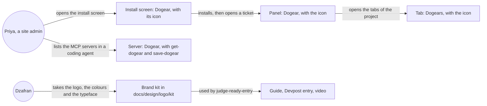

# Dogear brand

**Version:** v1 · **Status:** Draft · **Type:** Enhancement · **Project type:** Web UI

**Shape doc:** docs/specs/ticket-handover/shape.md
**Depends on:** stand-note, agent-checkpoint, at-risk-list, pick-up-brief

The app and its note get one name, Dogear, with a logo, an icon, and one brand kit for the
guide, the Devpost entry and the video. It ships now because the production deploy, the guide and the
video of `judge-ready-entry` carry the name and the icon.

## Problem

The app has a working name, Stand Note, and Forge's default icon. A judge meets the app in
five places: the install screen, the ticket, the list of MCP servers in a coding agent, the
Devpost entry and the video. Nothing ties the five together.

The app also has two words for one thing. The app is "Stand Note", and the note is a
"stand note". A new name for the app alone makes a third word.

The judges score design at 20%: "a complete, coherent product experience — not just a
technical proof of concept". The rules also say that the app must work as the video shows
it. The name in the video must be the name on the install screen.

A dog-ear is the folded corner of a page. It marks where a reader stopped. The app is
Dogear, and the note on a ticket is a dogear.

## Slice test

| Check                         | Result |
| ----------------------------- | ------ |
| Cuts every layer it needs     | yes — the app's name in Atlassian's developer console, the manifest, each text and tool name that says "stand note", the icon files, and the brand kit |
| One e2e test walks it         | yes — open the site's list of apps, a ticket and the Dogears tab, and read the name and the icon in each |
| Worth shipping alone          | yes — a person who installs the app sees one word and one mark in each place |
| Fits (≤5 scenarios, ≤2 areas) | yes — 4 scenarios, two areas: the app in Jira, and the brand kit |

**Path:** full — a new name in each text and tool, a new logo, and new files that other work uses.

## User story

As a Codegeist judge, I want one word and one mark on the install screen, the ticket, the
agent's tools and the video, so that I know that they are one product.

## Flow



Priya sees the word Dogear and its icon at the install, on the ticket, on the project tab
and in the agent. Dzafran builds the guide, the Devpost entry and the video from one kit.

## Acceptance criteria

```gherkin
Scenario: The site shows the app as Dogear
  Given the app is deployed to the development environment of dzaffren.atlassian.net
  When Dzafran opens the list of apps of the site in Atlassian Administration
  Then the list shows the app as "Dogear", with the Dogear icon
  And the list shows no app named "Stand Note"

Scenario: The ticket and the project say Dogear
  Given ticket PAY-142 got a note on 2026-11-21, before the rename
  When Aisyah Rahman opens PAY-142
  Then the panel header shows the Dogear icon beside the title "Dogear"
  And the panel shows the note from 2026-11-21, with its four texts
  When Aisyah opens a ticket with no note
  Then the panel says "No dogear yet"
  And the tab of project PAY has the title "Dogears", with the same icon
  And no text of the panel or of the tab says "stand note"
  And the icon reads at 16 pixels in Jira's light theme and in its dark theme

Scenario: A coding agent sees Dogear
  Given a coding agent is connected to the MCP server of the app
  When Dzafran lists the MCP servers and their tools in the agent
  Then the server's name is "Dogear"
  And its tools are "get-dogear" and "save-dogear"
  And no tool has "stand-note" in its name
  When the agent reads PAY-142 with "get-dogear"
  Then the answer starts with "Dogear on PAY-142"
  When the agent reads a ticket with a note that a script wrote through Jira's API
  Then the answer says "Saved outside Dogear"

Scenario: The brand kit has what the entry needs
  Given the kit is in docs/design/logo/kit
  When Dzafran opens the guidelines of the kit
  Then the kit has the symbol, the wordmark and the lockup of both, as SVG and as PNG
  And it has the app icon, for a light and for a dark background
  And it has the thumbnail image for the Devpost entry
  And the guidelines give the colours, the typeface and the tagline "Mark where you stopped."
  And the guidelines say how the name stands beside "Jira", by Atlassian's trademark rules
```

## Scope

**In:**

- The word Dogear in each place that a person or an agent sees: the app's name in
  Atlassian's developer console, the panel, the project tab, the pick-up brief, the name of
  the MCP server, the two tools and their answers, and the rule text for agents.
- The note is a "dogear". The panel's title is "Dogear", the tab's title is "Dogears", and
  the tools are `get-dogear` and `save-dogear`. Pause 2 lists each text, old and new.
- The README, the overview and the architecture doc say Dogear.
- The repo on GitHub gets the name `dogear`. Dzafran renames it, or approves the rename at
  the build.
- A logo for Dogear: a design brief, a few concepts to choose from, and the chosen mark.
- The app icon, on the app in Atlassian's lists, on the panel and on the Dogears tab.
- A brand kit: the logo files, the icon files, the colours, the typeface, the tagline, the
  thumbnail for Devpost, and short guidelines.

**Out:**

- The stored property of a note. It keeps the key `stand-note`, so each note from before
  the rename still shows. Nobody sees the key — not planned.
- The shipped specs, the decisions and the changelog. They keep their old text, as a
  record — not planned.
- A new look inside the panel and the tab. Forge UI Kit gives the app no control of colours
  or type (D3) — not planned.
- The guide, the Devpost entry, the video and the production deploy — `judge-ready-entry`.
- Images for a Marketplace listing — not planned. D1 aims for one bonus prize.
- The registration of Dogear as a trademark — not planned.

## Decisions to record

## D29 · 2026-11-23 · One word, Dogear, for the app and for its note

Why: a judge installs "Dogear" and then looks for that word on the ticket and in the
agent's tools. With one word, the install screen, the panel, the tab and the tools name the
same thing.
Rejected: a new name for the app alone, with "stand note" for the note (two words for one
product, and a judge who installs Dogear looks for a panel named "Stand note"), new titles
only (the panel's title says Dogear, and the text under it says "stand note").
Source: docs/specs/dogear-brand.md
Status: active

## Open items

| ID  | What | Type | Raised at | Owner | Status | Answer |
| --- | ---- | ---- | --------- | ----- | ------ | ------ |
| O1  | A judge installs "Dogear", and then looks for it on a ticket. The panel's title is "Stand note" and the tab's title is "Stand notes". Do the titles change? | question | spec p1 | user | Resolved | Yes, and the note changes too: "be consistent". The note is a "dogear" in each text that a person or an agent sees: the panel title "Dogear", "No dogear yet", "Use as dogear", the tab "Dogears", and the tools `get-dogear` and `save-dogear`. The stored property keeps its key. Shipped specs keep their old text. This replaces O6 of `judge-ready-entry`, which kept "stand note" for the note. Drafted as D29. 2026-11-23 |
| O2  | The repo becomes public in `judge-ready-entry`. Its name on GitHub is `CodegeistHackathon`. Does the repo get the name `dogear`? | question | spec p1 | user | Resolved | Yes. The public link reads `github.com/dzaffren/dogear`, and GitHub forwards the old link. 2026-11-23 |
| O3  | Which tagline goes with the name? | question | spec p1 | user | Resolved | "Mark where you stopped." It says what a dog-ear does. 2026-11-23 |
| O4  | Trademark trackers show no live US mark DOGEAR for software. Three old applications for software are dead: 77338159, 97416162 and 98265832. One live mark, "D DOGEAR", covers bags, in class 18. The trackers can lag the register, and nobody searched outside the US. | flag | spec p1 | user | Accepted risk | Go on with Dogear. The entry is a hackathon project with no Marketplace listing, and the US trackers show no live mark for software. Accepted 2026-11-23 |

_Never delete this section or its rows. See references/ledger.md._

## Glossary

- **Dogear (the app)** — the new name of the app. A dog-ear is the folded corner of a page.
- **Dogear (the note)** — the short note on a ticket that says where the work stands: done, next, watch out. Its old name was "stand note".
- **Brand kit** — one folder with the logo files, the icon files, the colours, the typeface and the rules for their use.
- **Symbol** — the picture part of a logo, with no letters.
- **Wordmark** — the name of the product, drawn as letters in the logo's typeface.
- **Lockup** — the symbol and the wordmark in one fixed layout.
- **Tagline** — one short line that goes with the name.
- **Forge** — Atlassian's platform for apps that run inside Jira and its other products.
- **Developer console** — Atlassian's site where a developer manages a Forge app: its name, its icon and its installs.
- **Manifest** — the file `manifest.yml`, which says what the app adds to Jira.
- **MCP** — Model Context Protocol, the standard way an AI agent calls outside tools.
- **MCP server** — the address where an agent finds the tools of the app.
- **UI Kit** — Forge's set of ready-made screen parts, such as buttons and messages.
- **Devpost** — the site that runs the hackathon and takes the entry.
- **SVG, PNG** — two image formats. SVG holds shapes and scales to any size. PNG holds pixels.
- **e2e** — end to end. An e2e test uses the app as a user does.
- **D1, D3** — entries in `DECISIONS.md`.
