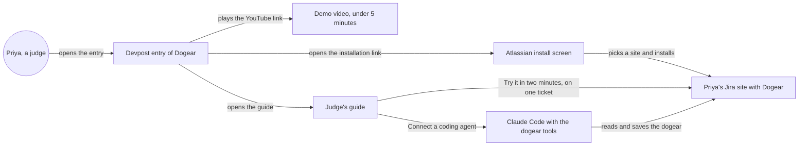
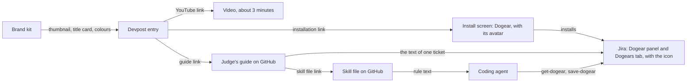

# Judge-ready entry

**Version:** v1 · **Status:** Draft · **Type:** Feature · **Project type:** Web UI

**Shape doc:** docs/specs/ticket-handover/shape.md
**Depends on:** stand-note, agent-checkpoint, at-risk-list, pick-up-brief, dogear-brand

A Codegeist judge installs Dogear from a link, follows a guide, and sees it work in two
minutes. The video and the Devpost entry go in before 2026-12-22 at 12:00 Pacific Time,
which is 2026-12-23 at 04:00 in Malaysia.

## Problem

The app runs only in the development environment of `dzaffren.atlassian.net`. A judge has
no link to install it, and the README is a guide for the developer, not for a judge. The
entry has no video and no Devpost text.

The judges score from 2027-01-05 to 2027-02-03, on their own Jira sites, with no help from
the developer. An entry that a judge cannot install fails the first stage.

### What the official rules ask

From the official rules on Devpost, which Dzafran pasted on 2026-11-23 (O5):

- The app installs in a judge's test environment from an installation link, and it works as
  the video and the text say.
- The entry gives each step that a judge needs to set the app up, with each integration.
- The video is shorter than 5 minutes, and judges need not watch more. It shows the app at
  work, and it is public on YouTube.
- The video has no third-party trademark, and no music or other material under copyright,
  unless the entrant has permission.
- The entry has a text description, says how it meets the Forge requirement, and names its
  category and its bonus prizes, with a write-up for each bonus prize.
- Each material is in English.
- The bonus prize "Best app with Atlassian MCP" is for a Forge app that exposes tools
  through the `rovo:mcp` module. The rules add that open-source `skill.md` files for
  third-party agents can go with it.
- Stage one is pass or fail: the entry fits the theme and uses Forge. Stage two has five
  criteria of equal weight:

| Criterion | The judges' question |
| --- | --- |
| Technological implementation | Is it a real, working, non-trivial app when tested, and not one fixed demo path? |
| Design | Is it a complete, coherent product, and not only a technical proof? |
| Potential impact | Is the case credible and specific, for a real problem and a real audience? |
| Innovation | How new is the idea, and how does it differ from what exists? |
| Presentation | Does the video show the app work end to end? Does the pitch say what problem, for whom, and why it matters? |

- An entry is a draft on Devpost until the entrant submits it. After the deadline, nothing
  changes.
- One entry can win one category prize and one bonus prize. The first 300 eligible entries
  get a swag pack, in the order of their arrival.

## Slice test

| Check                         | Result |
| ----------------------------- | ------ |
| Cuts every layer it needs     | yes — the production deploy, the installation link, the guide, the video and the Devpost entry |
| One e2e test walks it         | yes — one rehearsal as a judge: start at the Devpost entry, play the video, install on a clean site, follow the guide |
| Worth shipping alone          | yes — a judge can score the entry, and any Jira site can install the app |
| Fits (≤5 scenarios, ≤2 areas) | yes, at the limit — 5 scenarios, two areas: the app in production with its guide, and the entry on Devpost |

**Path:** full — a production deploy, a new guide, a video and a submission.

If the slice grows, the video and the Devpost entry split off as their own slice,
`submit-entry`.

## User story

As a Codegeist judge, I want to install Dogear and see it work in two minutes, so that
I can score it with no help from the developer.

## Flow



Priya starts at the Devpost entry. Priya plays the video, installs the app from the link,
and follows the guide on one ticket. A judge with Claude Code also connects the agent's tools.

## Acceptance criteria

```gherkin
Scenario: A judge installs the app from the link
  Given the Devpost entry of Dogear shows the installation link
  And Priya Nair is the admin of a Jira site where Dogear was never installed
  And Priya is not the developer of Dogear
  When Priya opens the link, picks that site and installs the app
  Then the install ends with no error
  And a ticket of that site shows the Dogear panel in the right column
  And the Dogear panel and the Dogears tab show the Dogear icon, in Jira's light theme and in its dark theme

Scenario: The judge sees the app work in two minutes
  Given Dogear is installed on Priya's site
  And the guide's part "Try it in two minutes" gives the summary and the description of one ticket
  When Priya makes that ticket, "Refund fails on a partial capture", and moves it to In Progress
  Then the Dogears tab of the project lists the ticket with "No dogear"
  When Priya opens the ticket and selects "Build a brief from Jira"
  Then the panel shows a brief with the headings Done, Next, Watch out and Code
  When Priya selects "Use as dogear" and selects Save
  Then the panel shows the dogear with "Saved by Priya Nair, just now"
  And the Dogears tab does not list the ticket
  And the rehearsal of this part takes 2 minutes or less on a stopwatch

Scenario: The judge connects a coding agent
  Given Dogear is installed on Priya's site
  And the ticket "Refund fails on a partial capture" has the dogear from the second scenario
  And Priya has Claude Code on a laptop
  When Priya follows the guide's part "Connect a coding agent"
  Then the skill file from the guide's link opens on GitHub with no sign-in
  And Claude Code lists the two tools under the names that the guide gives
  And "Read the dogear" in Claude Code answers with the text of the dogear
  When Claude Code saves a dogear with Next "Add a test for a capture of 40 of 100 MYR"
  Then the Dogear panel of the ticket shows that Next

Scenario: The demo video is public
  Given the demo video is on YouTube
  When a person with no YouTube sign-in opens the link from the Devpost entry
  Then the video plays, and it is shorter than 5 minutes
  And it shows the production app: a dogear in the panel, a coding agent with the two tools, the Dogears tab and a pick-up brief
  And it says what the problem is, who has it, and why it matters
  And it gives one figure from Atlassian's State of Developer Experience report, with the source on screen
  And it is in English, with no third-party trademark and no music under copyright

Scenario: The entry is submitted
  Given the Devpost form of Dogear has the category "Apps for Software Teams"
  And it names the bonus prize "Best app with Atlassian MCP"
  And it has the text description, the use of Forge and Jira, the write-up for the bonus prize, the installation link, the guide and the YouTube link
  When Dzafran selects Submit before 2026-12-22 at 12:00 Pacific Time
  Then Devpost shows Dogear as submitted to Codegeist 2026
```

## Scope

**In:**

- A deploy of Dogear to the production environment of Forge, and an installation link
  that works on a site of another person.
- A judge's guide with three parts: install, "Try it in two minutes", and "Connect a coding
  agent". It names each thing that a site needs first, as the rehearsal finds it.
- One rehearsal on a clean site, with a stopwatch. It includes one pick-up brief in
  production.
- The text of the Devpost entry: the description, the use of Forge and Jira, the category,
  and the part for the bonus prize.
- The script of the demo video, and the video itself, from the screen-demo pipeline of
  OpenMontage. Dzafran puts the video on YouTube.
- This repo becomes public on GitHub, with a licence and the skill file for coding agents.
  A check of the files and the git history for secrets comes first. Dzafran makes the repo
  public.
- One published figure for the pitch, with its source.
- The icon of the Dogear panel and of the Dogears tab in Jira: a PNG at a public web
  address (D31), set in the manifest after the repo is public.
- Dzafran submits the entry on Devpost. Nothing goes to Devpost or YouTube without Dzafran.

**Out:**

- A listing on the Atlassian Marketplace — not planned. D1 aims for one bonus prize.
- A button that makes sample tickets on the judge's site — not planned. See O2.
- The rename of the app to Dogear, the logo, the app's avatar and the brand kit that the
  guide, the Devpost entry and the video share — `dogear-brand`, which shipped on 2026-11-23.
- New features, and fixes that a judge does not hit — not planned before the deadline.
- Help for a judge during the scoring, such as a support address — not planned.

## Interface

This slice adds no screen to the app. Its interface is what a judge meets: the Devpost
entry, the video, the guide, the skill file, and one icon in Jira.

**Design system:** inside Jira, Forge UI Kit (D3), with one new icon and no new component.
Outside Jira, the brand kit of `dogear-brand`: `docs/design/logo/kit/guidelines.md` gives
the logo, the three colours and the typeface.

**Motion tier:** 0 in the app. The motion of the video is planned in the `art-direction.md`
of the OpenMontage project, from the kit's colours and typeface.

**Preview:** none. Each text is a Markdown file that the build writes. The script of the
video gets its own approval at the script stage of the OpenMontage pipeline.



The Devpost entry is the door. It links to the video, to the install screen and to the
guide. The guide gives the text of one ticket, and it links to the skill file.

### The judge's guide

One page, in English: `GUIDE.md` at the root of the public repo. The first line of the
README links to it. Each step is one action and what the judge then sees.

| Part | What it has |
| ---- | ----------- |
| Before you start | A Jira site where you are an admin. For the last part only: Claude Code. |
| 1. Install | The installation link. Pick the site. Open a ticket, and select Allow access in the Dogear panel. |
| 2. Try it in two minutes | Six steps on one ticket, below. |
| 3. Connect a coding agent | Turn on "Expose tools to MCP-compatible apps". Add the server as `dogear`. Sign in. Add the skill file. Two prompts to try: "Read the dogear of" the ticket, and "Save a dogear" with a new Next. |
| If a step fails | Each failure that the rehearsal finds, with its fix. |

**Try it in two minutes:**

1. Make a ticket with the summary and the description below. Move it to In Progress.
2. Open the Dogears tab of the project. It lists the ticket with "No dogear".
3. Open the ticket. In the Dogear panel, select "Build a brief from Jira".
4. Read the brief: Done, Next, Watch out, Code.
5. Select "Use as dogear", then Save. The panel shows "Saved by" your name.
6. Open the Dogears tab again. The ticket is gone from the list.

**The ticket's text**, which the judge copies:

> Summary: Refund fails on a partial capture
>
> Description: A refund fails with error 422 when the order was captured in part. Example:
> the order is for 100 MYR, the capture is 40 MYR, and a refund of 40 MYR is refused. The
> refund check compares the refund with the authorised amount and not with the captured
> amount. Done: the failure is reproduced on staging, and `refund.test.js` has a failing
> test for it. Next: fix the check in `refundService.js`. Watch out: do not change the path
> for a full capture. Branch: `fix/partial-capture-refund`.

The description names something for each heading, so the brief has no "Not known" line.

### The skill file

The skill file is `skills/dogear/SKILL.md`, in the folder form that Claude Code loads as a
skill: a name, a description, and the rule text. The guide gives the same rule text as a
block for `AGENTS.md`, for other agents. The rule text is what the README has today under
"## Dogear": take the
ticket key from the branch, read the dogear first, save after each step and before you
stop, read before each save, write for a teammate. It names the two tools.

### The Devpost entry

The build writes these texts to `docs/entry/devpost.md`, for the usual fields of Devpost.
Nobody saw the form of Codegeist (O12), so the texts get fitted when Dzafran starts the
draft.

| Field | Text |
| ----- | ---- |
| Name | Dogear |
| Tagline | Mark where you stopped. |
| Short pitch | Dogear keeps a short, current note on each Jira ticket. People and their coding agents keep it, so a teammate picks the ticket up and carries on. |
| Thumbnail | `docs/design/logo/kit/png/devpost-thumbnail.png` |
| Gallery | Four screenshots from production: the panel with a dogear, the agent's terminal with the panel beside it, the Dogears tab, a pick-up brief. |
| Category | Apps for Software Teams |
| Bonus prize | Best app with Atlassian MCP |
| Links | The installation link, the guide, the repo, the YouTube video |
| Built with | Forge, UI Kit, Jira issue properties, the `rovo:mcp` module, Forge LLM, Jira REST API |

The story has these parts. Each one answers a criterion of the judges.

| Part | What it says | Criterion |
| ---- | ------------ | --------- |
| The problem | A ticket changes hands, and the next person starts from zero. The figure, with its source. Who has the problem: a team where people and coding agents share tickets. | Potential impact |
| What it does | The dogear in the panel. The two tools for a coding agent. The Dogears tab for a lead. The pick-up brief for a ticket with no dogear. | Design |
| How it uses Forge | Each Forge module and what it does. The dogear is an issue property, so the data stays in Jira. Each call to Jira runs as the person. | Technological implementation |
| What is new | An agent keeps the handover note as it works, and a second agent reads it. A status field and a comment thread do not do this. | Innovation |
| The MCP bonus | The `rovo:mcp` module with two tools. The tools act as the person. The panel says when an agent saved. The open-source skill file. | The bonus prize |
| How to test it | The steps of the guide, in short, with the link to the guide. | Stage one |

**The figure:** "50% of developers lose 10 or more hours a week to non-coding work, and
finding information is the top time-waster." Source: Atlassian, State of Developer
Experience 2025, a survey of 3,500 developers and managers. The 2026 report puts finding
information first again, with no figure for hours. Both posts were read on 2026-11-23:
https://www.atlassian.com/blog/bitbucket/developer-experience-report-2025 and
https://www.atlassian.com/blog/development/developer-experience-report-2026. The figure is
about lost time and finding information. It is not a count of handovers, and the pitch
does not say that it is.

### The video

About 3 minutes. The voice says "a coding agent", and the terminal shows no product name
(O7). The people in it are Aisyah Rahman and Hafiz Omar, the two test personas.

| Time | Beat | On screen |
| ---- | ---- | --------- |
| 0:00 to 0:25 | The problem. Aisyah is off sick, and Hafiz picks up her ticket with no idea where it stands. The figure. | Title card with the logo, then the figure with its source |
| 0:25 to 0:55 | The dogear. Aisyah saves Done, Next, Watch out and Code. Hafiz opens the ticket and reads it. | The Dogear panel |
| 0:55 to 1:45 | The coding agent. It reads the dogear, does one step, and saves. The panel says that an agent saved. A second agent carries on from Next. | A terminal, with the panel beside it |
| 1:45 to 2:10 | The lead. One tab lists each in-progress ticket with no dogear, or a dogear that is behind. | The Dogears tab |
| 2:10 to 2:40 | The pick-up brief. A ticket with no dogear gets a brief from what Jira has, and Hafiz saves it as the dogear. | The panel with a brief |
| 2:40 to 3:00 | How it is built, and where to get it. | The Forge modules as a short list, then the logo, the tagline and the link |

## Decisions to record

## D32 · 2026-11-23 · The pitch cites published surveys

Why: judges score a "credible, specific case", and a judge can open the source of a
published figure.
Rejected: a count from the developer's own team (one team's number, with no source that a
judge can check), no number (the case stays a story).
Source: docs/specs/judge-ready-entry.md
Status: active

## D33 · 2026-11-23 · The judge's worked example is a guide, with no sample-ticket button

Why: the guide gives the text of one ticket, and that ticket shows the Dogears tab, the
brief and the dogear. The app gets no new code before the deadline.
Rejected: a button that makes sample tickets (new code that writes tickets to the site of a
stranger, and one more thing to test in production).
Source: docs/specs/judge-ready-entry.md
Status: active

## D34 · 2026-11-23 · The rehearsal runs on a new site of a second account

Why: a judge is not the developer of the app. Only a second account shows what a stranger
sees at the install, at the consent and at the first brief.
Rejected: a second site of the developer's account (the developer owns the app, so the
install can differ), no clean site (nobody tests a first install).
Source: docs/specs/judge-ready-entry.md
Status: active

## D35 · 2026-11-23 · The demo video comes from the screen-demo pipeline of OpenMontage

Why: the same pipeline made the videos of KinCart and Fire Watch, so its tools and its
steps are known. A change of the script needs a new render, not a new take.
Rejected: a screen recording with the developer's voice (each change needs a new take),
captions with no voice (judges score presentation at 20%).
Source: docs/specs/judge-ready-entry.md
Status: active

## D36 · 2026-11-23 · The repo becomes public, with the skill file in it

Why: the text of the MCP bonus prize names open-source `skill.md` files for third-party
agents. One public repo holds the app and the skill file, and a judge can read the code.
Rejected: a small public repo with only the skill file (two repos, and the skill file can
drift from the app), the block in the guide only (nothing is open source).
Source: docs/specs/judge-ready-entry.md
Status: active

## D37 · 2026-11-23 · The judge's guide is GUIDE.md at the repo root

Why: a judge and a developer need different pages. One file for the judge takes one link
from the Devpost entry, and the README keeps its generated block.
Rejected: the judge's parts at the top of the README (one file for two readers), the steps
only in the Devpost text (the repo has no guide, and a change after the deadline is not
possible).
Source: docs/specs/judge-ready-entry.md
Status: active

## D38 · 2026-11-23 · The skill file is skills/dogear/SKILL.md

Why: Claude Code loads this folder form as a skill, so a judge adds it with one copy. The
guide gives the same rule text as a block for other agents.
Rejected: a plain `skill.md` at the repo root (no agent loads it as it is; a person pastes
its text).
Source: docs/specs/judge-ready-entry.md
Status: active

## Open items

| ID  | What | Type | Raised at | Owner | Status | Answer |
| --- | ---- | ---- | --------- | ----- | ------ | ------ |
| O1  | The pitch has no number for how often a ticket changes hands or what a bad handover costs. Judges score a "credible, specific case". Which number does the pitch use? (from shape O7) | flag | shape | user | Resolved | Published surveys: Atlassian's State of Developer Experience 2025 and the Stack Overflow survey of 2022. They measure lost time and knowledge silos, not handovers alone. The build reads each figure at its primary source, and the video shows one with its source. Drafted as D32. 2026-11-23. The figure in the video is from Atlassian's report, because the rules bar third-party trademarks in the video. 2026-11-23 |
| O2  | A judge's site has no stand notes. How does the judge get a worked example? | question | spec p1 | user | Resolved | The guide only. It gives the text of one ticket, and the judge makes the ticket. The app gets no new code. Drafted as D33. 2026-11-23 |
| O3  | The rehearsal needs a clean site: Stand Note never installed, and an admin who is not the developer. Who makes it? | question | spec p1 | user | Resolved | Dzafran signs up a second Atlassian account with another email and makes a free Jira site. Drafted as D34. 2026-11-23 |
| O4  | How is the demo video made? | question | spec p1 | user | Resolved | The same way as the videos of KinCart and Fire Watch: the screen-demo pipeline of OpenMontage. Playwright records the browser, a paid text-to-speech voice reads the script, and Remotion joins them with titles and captions. The Claude Code part is a terminal, so pause 3 plans its capture. Drafted as D35. 2026-11-23 |
| O5  | Assuming the rules are as three secondary pages give them: an installation link with instructions, a public YouTube video under 5 minutes that covers the bonus prize, a text description, and five criteria at 20% each. Devpost refused the read of the official page. One page also says "no third-party trademarks" in the video, and the video shows Claude Code. | assumption | spec p1 | user | Resolved | Dzafran pasted the official rules on 2026-11-23, after Chrome hit a bot check. The secondary pages were right, with three changes. The video limit is 5 minutes, with no 3-minute clause. The rule on third-party trademarks is real: see O7. The three prizes are for each category. The Problem section lists what the rules ask. 2026-11-23 |
| O6  | The working name is Stand Note. Is it the name of the entry? | question | spec p1 | user | Resolved | No. The name is Dogear: the folded page corner that marks where a reader stopped. The note in the panel stays a "stand note". Understudy was the first pick, but a US trademark application for UNDERSTUDY is pending for AI developer tools, and an open-source AI agent has the name. A web search found no product named Dogear. Nobody searched the trademark register. 2026-11-23. Changed by O1 of `dogear-brand` on 2026-11-23: the note is a "dogear" too. The texts of this spec follow at its next pause. |
| O7  | The rules say that the video "must not include third party trademarks" with no permission. The video shows Claude Code, which is Anthropic's name and logo. | flag | spec p1 | user | Resolved | Hide the brand. The video shows the agent's terminal at work, with no product name and no logo, and the voice says "a coding agent". The written guide still names Claude Code, because a judge needs the exact steps. 2026-11-23 |
| O8  | The text of the MCP bonus prize names open-source `skill.md` files that users add to their agents. The README has that text as a block to copy, and this repo is private. Does the entry ship a public skill file? | question | spec p1 | user | Resolved | Yes. This repo becomes public on GitHub, with the skill file in it and a licence. A check of the files and the git history for secrets comes first. Dzafran makes the repo public. Drafted as D36. 2026-11-23 |
| O9  | Judges score design at 20%: "a complete, coherent product". The app has Forge's default icon. Is an icon for Dogear in this slice? | question | spec p1 | user | Resolved | No. The rename, the logo, the icon and the shared look are their own slice, `dogear-brand`, which ships first. This slice depends on it. A third area would break the size limit of this spec. 2026-11-23 |
| O10 | From O6 of `dogear-brand`: the icon of the panel and of the Dogears tab is a PNG at a public web address. This slice adds the address to the manifest after the repo is public, and checks the icon at 16 pixels in Jira's light theme and in its dark theme. | flag | spec p1 | user | Resolved | Dzafran chose the web address on 2026-11-23, in `dogear-brand`. Recorded there as D31. The scenarios of this spec take it in at the next pause. 2026-11-23 |
| O11 | Where does the judge's guide live? | question | spec p2 | user | Resolved | `GUIDE.md` at the repo root. The first line of the README links to it, and so does the Devpost entry. The README stays the developer's page. Drafted as D37. 2026-11-23 |
| O12 | Assuming the Devpost form of Codegeist has the usual Devpost fields: name, tagline, a story in Markdown, built with, links, a video link, a thumbnail and a gallery. Devpost refuses automated reads, so nobody saw the form. | assumption | spec p2 | user | Accepted risk | The build writes each text to a Markdown file for the usual fields. When Dzafran starts the draft on Devpost, Dzafran pastes the form's field list, and the build fits the texts then. A wrong guess costs a change of text, not of the app. 2026-11-23 |
| O13 | How long is the video? The rules allow less than 5 minutes, and judges need not watch more. | question | spec p2 | user | Resolved | About 3 minutes, in six beats. 2026-11-23 |
| O14 | Which form and place does the skill file have? The bonus prize text says "open-source `skill.md` files". | question | spec p2 | user | Resolved | `skills/dogear/SKILL.md`, in the folder form that Claude Code loads as a skill. The guide gives the same rule text as a block for `AGENTS.md`, for other agents. Drafted as D38. 2026-11-23 |

_Never delete this section or its rows. See references/ledger.md._

## Glossary

- **Dogear** — the app. Also the short note on a ticket that says where the work stands: done, next, watch out, code. The note is a "dogear", with a small d.
- **Pick-up brief** — a short text that AI builds from a ticket's Jira data, for a person who picks up a ticket with no dogear.
- **Forge** — Atlassian's platform for apps that run inside Jira and its other products.
- **Devpost** — the site that runs the hackathon and takes the entry.
- **Codegeist** — Atlassian's yearly hackathon for Forge apps.
- **Production environment** — the Forge copy of the app that other sites install. The app runs only in the development copy today.
- **Installation link** — a link from Atlassian's developer console that lets an admin install the app on a site.
- **Clean site** — a Jira site where Dogear was never installed, with an admin who is not the developer.
- **Rehearsal** — one timed run through the entry as a judge, on the clean site.
- **OpenMontage** — the developer's tool that makes a video from a script, a screen capture and a voice.
- **Remotion** — a tool that builds a video from code.
- **Text-to-speech** — software that reads a text aloud.
- **Playwright** — a tool that drives a real browser from a script.
- **Skill file** — a text file of instructions that a person gives to their own coding agent.
- **MCP** — Model Context Protocol, the standard way an AI agent calls outside tools.
- **Coding agent** — an AI tool that writes code for a developer, such as Claude Code.
- **Atlassian Marketplace** — Atlassian's public store for apps.
- **e2e** — end to end. An e2e test uses the app as a user does.
- **D1** — the first entry in `DECISIONS.md`.
