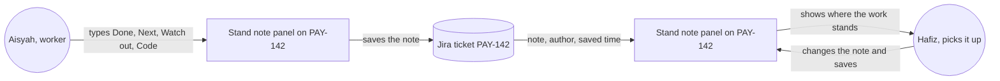
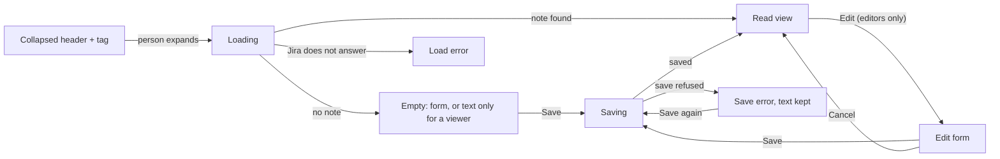
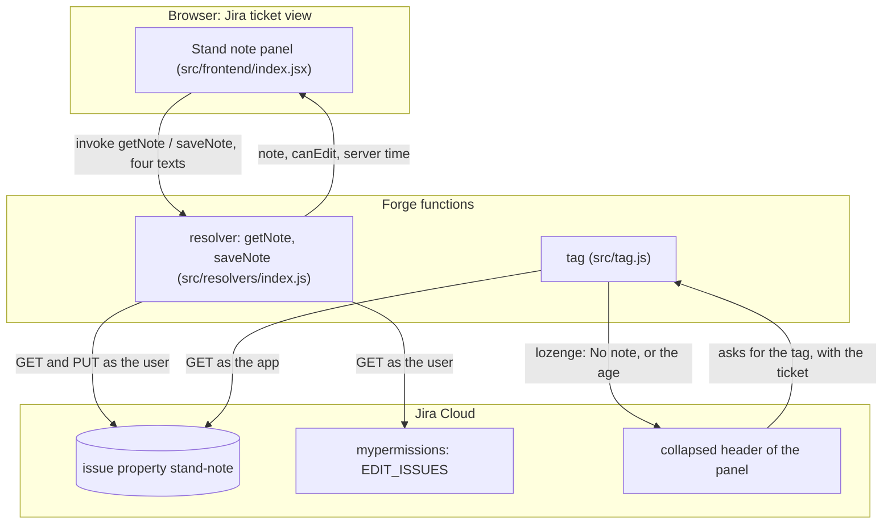
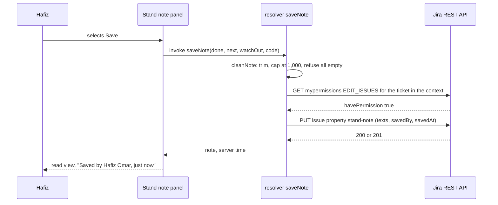
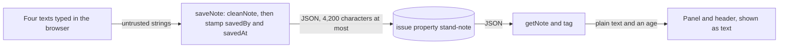

# Stand note

**Version:** v1 · **Status:** Refined · **Type:** Skeleton · **Project type:** Web UI

**Shape doc:** docs/specs/ticket-handover/shape.md
**Depends on:** None

A person saves a short note on a Jira ticket that says where the work stands, and
anyone who opens the ticket reads it. It ships first because it proves the Forge
rails, and each later slice reads or writes this note.

## Problem

When a ticket changes hands mid-flight, the person who picks it up can see what it
asks for but not where the work stands. They message someone who may not answer, or
they start over. Today the ticket has no place for that state: the team pastes a link
in the description or a comment when someone remembers.

## Slice test

| Check                         | Result                                                              |
| ----------------------------- | ------------------------------------------------------------------- |
| Cuts every layer it needs     | yes — panel on the ticket, save, data on the ticket, deployed on Forge |
| One e2e test walks it         | yes — save a note on a ticket, open the ticket again, read the note |
| Worth shipping alone          | yes — a team can keep a stand note by hand                          |
| Fits (≤5 scenarios, ≤2 areas) | yes — 5 scenarios, one area: the note panel                         |

**Path:** full — a new app on an empty repo, with a new interface.

## User story

As a developer who stops work on a ticket, I want to leave a short note of where the
work stands, so that a teammate carries on without a message to me.

## Flow



Aisyah saves a four-field note on the ticket, and Hafiz opens the same ticket later,
reads the note with its author and age, and saves his own changes.

## Acceptance criteria

```gherkin
Scenario: Save the first note
  Given ticket PAY-142 "Add refund endpoint" has no stand note
  And Aisyah Rahman can edit PAY-142
  When Aisyah opens PAY-142
  Then the Stand note header in the right column shows the tag "No note"
  When she expands Stand note
  Then the panel says "No stand note yet"
  And Save is not available while all four fields are empty
  When she types Done "Endpoint and validation are written"
  And she types Next "Add the idempotency check"
  And she types Watch out "The sandbox rejects amounts over RM 5,000"
  And she types Code "feat/pay-142-refund"
  And she selects Save
  Then the panel shows the four fields as she typed them
  And the panel says "Saved by Aisyah Rahman, just now"

Scenario: Read the note on a ticket that changed hands
  Given Aisyah saved a stand note on PAY-142 on 2026-11-24 at 16:40
  When Hafiz Omar opens PAY-142 on 2026-11-26 at 09:15
  Then the Stand note header shows the tag "2 days ago"
  When he expands Stand note
  Then the panel shows Done, Next, Watch out and Code as Aisyah saved them
  And the panel says "Saved by Aisyah Rahman, 2 days ago"

Scenario: A new save replaces the note
  Given PAY-142 has the stand note that Aisyah saved
  And Hafiz Omar can edit PAY-142
  When Hafiz expands Stand note
  And he changes Done to "Endpoint, validation and idempotency check are written"
  And he changes Next to "Write the tests for partial refunds"
  And he selects Save
  Then the panel shows Hafiz's text in Done and Next
  And the panel says "Saved by Hafiz Omar, just now"
  And Aisyah's earlier text for Done and Next is gone

Scenario: A person who can only view the ticket reads the note
  Given PAY-142 has the stand note that Hafiz saved
  And Tan Mei Ling can view PAY-142 but cannot edit it
  When Mei Ling opens PAY-142 and expands Stand note
  Then the panel shows the four fields and "Saved by Hafiz Omar"
  And the panel has no Edit control and no Save control

Scenario: The save fails
  Given Aisyah typed Next "Add the idempotency check" on PAY-142
  When she selects Save and Jira does not accept the save
  Then the panel says "The note was not saved. Try again."
  And her text stays in the fields
  And the note on the ticket is the same as before
```

## Scope

**In:**

- A Stand note panel in the right column of the Jira ticket view. It starts collapsed.
- A tag on the collapsed header: "No note", or the age of the note, such as "2 days ago".
- Four short free-text fields: Done, Next, Watch out, Code. Each holds up to 1,000
  characters. Each is optional, but a save needs text in one or more of them.
- One note for each ticket. A save replaces the note.
- The saved line: who saved the note, and how long ago.
- A person who can edit the ticket can save the note. A person who can view the
  ticket can read it.
- When two people save at the same moment, the later save wins, with no warning.
- The app runs on the developer Jira site, in the Forge development environment.
- Vitest unit tests, and one Playwright e2e test that walks the slice.

**Out:**

- A coding agent saves the note — `agent-checkpoint`.
- A warning that work moved after the note was saved — `at-risk-list`.
- A search for tickets by their note — `at-risk-list`.
- A production deploy and the install link for judges — `judge-ready-entry`.
- The history of earlier notes — no slice yet.
- A warning when two people edit at the same time — no slice yet.
- A control that clears the note — no slice yet.
- CI — not planned. The tests run by hand before each deploy.

## Interface

**Design system:** Forge UI Kit, which is Atlassian's own component set (D3). The app adds no
tokens and no components of its own. UI Kit follows the Jira theme, light or dark.

**Motion tier:** 0. UI Kit gives the app no control of motion. A state change is instant, and
the spinner on the Save button is Atlassian's.

**Reference:** Jira's own Details panel, for a quiet label above each value in a narrow column.
From Stripe's forms: an error sits next to the button that caused it, and the typed text stays.

**Preview:** the wireframes below. UI Kit renders only inside Jira, so an HTML copy would not
show the real components. The build shows the real panel on `dzaffren.atlassian.net`.



A person expands the panel, sees the note or an empty form, and an editor moves between the
read view and the form with Edit, Save and Cancel.

### The collapsed header

```
> Stand note   Where the work stands        [ No note ]      grey tag
> Stand note   Where the work stands        [ 2 days ago ]   blue tag
```

- Title: `Stand note`. Label: `Where the work stands`.
- Tag with no note: `No note`.
- Tag with a note: the age of the note. `Just now` under 1 minute, then `5 min ago`,
  `3 hours ago`, `2 days ago`.

### Read view

```
v Stand note   Where the work stands        [ 2 days ago ]
  Done
  Endpoint and validation are written
  Next
  Add the idempotency check
  Watch out
  The sandbox rejects amounts over RM 5,000
  Code
  feat/pay-142-refund
  Saved by Aisyah Rahman, 2 days ago
  [ Edit ]
```

- The view shows only the fields that have text.
- Code that starts with `https://` is a link that opens in a new tab. Other text shows as code.
- A person who cannot edit the ticket gets the same view with no Edit button.

### Form: the empty state for an editor, and Edit

```
v Stand note   Where the work stands        [ No note ]
  No stand note yet
  Say where the work stands, so a teammate can carry on.
  Done
  [ What is finished                      ]
  Next
  [ The next step                         ]
  Watch out
  [ Traps, and what you tried that failed ]
  Code
  [ Branch name or link                   ]
  [ Save ]  [ Cancel ]
```

- Done, Next and Watch out are text areas of two rows that grow. Code is one line.
- Each field stops at 1,000 characters.
- Save is disabled while all four fields are empty.
- The two "No stand note yet" lines and the missing Cancel button are for the empty state only.
  In Edit, the fields hold the saved text, and Cancel goes back to the read view.
- A viewer with no note sees only `No stand note yet`.

### Saving, and the two errors

```
  [ (spinner) Save ]  [ Cancel ]          fields are read-only during the save

  (!) The note was not saved. Try again.  above the buttons; the text stays

  (!) The note did not load. Reload the page.   in place of the note
```

**Components used:** Stack, Inline, Text, Label, TextArea, Textfield, Form, FormFooter, Button,
LoadingButton, SectionMessage, Spinner, User, Link, Code. The header tag is the `status` lozenge
of the issue context module.

**The two craft checks.** A one-line prompt gives a single notes box. This panel has four fields
named for a handover, opens on the read view, and shows the age of the note before a click. Next
to Jira's Details panel it uses the same label-above-value rhythm and no colour of its own.

## Stack

The developer chose each of these on 2026-11-20. This is the record for the project.

| Layer           | Choice                                                         |
| --------------- | -------------------------------------------------------------- |
| Host and deploy | Atlassian Forge, deployed with `forge deploy` from the laptop  |
| Language        | JavaScript                                                     |
| UI              | Forge UI Kit for the stand-note panel                          |
| Data            | A Jira issue property on each ticket                           |
| Package manager | npm                                                            |
| Unit tests      | Vitest                                                         |
| e2e tests       | Playwright on the real Jira site, with a login saved by hand   |
| CI              | None                                                           |
| Jira site       | `dzaffren.atlassian.net`, the developer's own site                |

### Spike findings, 2026-11-20

A throwaway hello-world app answered O1, O2 and O5. The spike code is deleted.

- `forge create -t jira-issue-context-ui-kit -s <developer space id> -y <name>` makes the app with no prompts.
  The developer space is `dzaffren-dev`.
- The template uses `@forge/react`, `@forge/bridge` and a resolver function, on runtime `nodejs24.x`.
- `forge deploy --non-interactive -e development`, then `forge install --non-interactive --site
  dzaffren.atlassian.net --product jira -e development --confirm-scopes`, puts the app on the site.
- The Forge CLI reads `FORGE_EMAIL` and `FORGE_API_TOKEN` from the environment. The token is in `.env`
  as `ATLASSIAN_API_KEY`. Git ignores `.env`.
- UI Kit renders in the main page, not in a frame. Playwright finds the panel header as a button with
  the module title in its name, and it finds the panel text with a plain text locator.
- The panel starts collapsed in each new browser session. A test must expand it first.
- Google refuses sign-in in Playwright's browser. The e2e account is a second Atlassian account with an
  email and a password. Its saved login is in `e2e/.auth/state.json`, which git ignores.
- A new account lands on a Jira welcome page until it picks a kind of work. The test account did that once.
- The site's "Default software scheme" lets each logged-in Jira user edit tickets. A view-only person
  exists only when the "any logged-in user" grant for Edit Issues is removed. The spike removed the grant
  through the Jira API, ran the test, and put the grant back.
- Only the test account can log in to Playwright. The main account can still act in a test through the
  Jira API with its token.
- `npm install -g @forge/cli` skipped the install scripts of `cloudflared` and `keytar`. `forge tunnel`
  may need them.

## Technical plan

### Approach

The app is one Forge app at the repo root. The panel is UI Kit code that calls two backend
functions, `getNote` and `saveNote`, and a third function gives Jira the tag for the collapsed
header. The note is one JSON value in the Jira issue property `stand-note` on the ticket.

The backend reads and writes as the person who uses the panel, so Jira's own permissions apply.
The backend takes the ticket from the Forge context and stamps the author and the time. The
browser sends only the four texts.

Relies on: D2, D3, D4, D5, D6, D7, D8, D9, D10, D11



The panel talks only to the resolver, the resolver talks to Jira as the user, and Jira asks the
tag function for the text on the collapsed header.





The four texts are the only input from the browser, the backend cleans and stamps them, and the
panel shows them as plain text.

### Changes

The repo has no app code yet, so each file is new.

| File | What changes | Why |
| ---- | ------------ | --- |
| `manifest.yml` | One `jira:issueContext` module `stand-note-panel`: title `Stand note`, label `Where the work stands`, status lozenge `No note`, `dynamicProperties` to `tag`, resolver to `resolver`. Two function modules. Scopes `read:jira-work` and `write:jira-work`. Runtime `nodejs24.x`. | All scenarios, D8 |
| `package.json`, `package-lock.json` | Dependencies `@forge/react`, `@forge/bridge`, `@forge/resolver`, `@forge/api`. Dev dependencies `vitest`, `@playwright/test`. The npm scripts in the test plan. | D5, D6 |
| `.nvmrc` | `24.22.3` | O5 |
| `scripts/forge.sh` | Loads `.env`, sets `FORGE_API_TOKEN` from `ATLASSIAN_API_KEY`, switches to the Node in `.nvmrc`, runs `forge` with the arguments it gets. | Deploy with no secret on screen |
| `src/index.js` | Exports `handler` (the resolver) and `tag`. | Forge entry points |
| `src/resolvers/index.js` | `getNote`: reads the property and the edit permission as the user, returns the note, `canEdit` and the server time. `saveNote`: cleans the texts, checks the edit permission, writes the property, logs one line. | Scenarios 1 to 5 |
| `src/tag.js` | The `dynamicProperties` handler. Reads the property as the app and returns the lozenge. | Scenarios 1 and 2 |
| `src/lib/note.js` | `PROPERTY_KEY`, and `cleanNote(input)`: trim, cap each field at 1,000 characters, refuse a note with four empty fields. | Scenario 1, the limits in Scope |
| `src/lib/age.js` | `ageLabel(savedAt, now)`: `Just now`, `5 min ago`, `3 hours ago`, `2 days ago`. The panel and the tag both use it. | Scenarios 1 and 2 |
| `src/frontend/index.jsx` | `App`: loading, load error, and the switch between the read view and the form. | All scenarios |
| `src/frontend/NoteView.jsx` | The read view: the filled fields, the saved line, the Edit button for an editor. | Scenarios 2 and 4 |
| `src/frontend/NoteForm.jsx` | The form: four fields in React state, Save disabled while all are empty, Cancel, the save error. | Scenarios 1, 3 and 5 |
| `test/note.test.js`, `test/age.test.js`, `test/resolvers.test.js` | Vitest unit tests. The resolver tests mock `@forge/api`. | Test plan |
| `playwright.config.js` | One Chromium project that uses `e2e/.auth/state.json`. Loads `.env` with `process.loadEnvFile`. | D6 |
| `e2e/login.mjs` | Opens a browser for the hand login of the test account and saves the session. | O1 |
| `e2e/jira.js` | Jira API helpers that act as the main account: find or create the test tickets, set and delete the property. | Scenarios 2 and 4 |
| `e2e/setup-site.mjs` | One-time site setup: the view-only test project and its permission scheme. | D10 |
| `e2e/stand-note.spec.js` | The five scenarios. | Test plan |

Reusing: the `jira-issue-context-ui-kit` template from `forge create`. The build makes the app
with `forge create` in a temporary folder and moves the files to the repo root, with the flags
in "Spike findings".

### Data

One value for each ticket, in the issue property `stand-note`:

```json
{
  "v": 1,
  "done": "Endpoint and validation are written",
  "next": "Add the idempotency check",
  "watchOut": "The sandbox rejects amounts over RM 5,000",
  "code": "feat/pay-142-refund",
  "savedBy": "712020:0f6c1c1e-0000-4000-8000-000000000142",
  "savedAt": "2026-11-24T08:40:00.000Z"
}
```

**Migration:** none. The property is new, and a ticket with no property has no note.
**Reverse:** `forge uninstall` removes the panel. The properties stay on the tickets as unused
JSON, and `e2e/jira.js` has the delete call that removes one.

### Earn-it

| Added | Triggered by |
| ----- | ------------ |
| Resolver functions `getNote` and `saveNote` | Scenario 2: "2 days ago" must be right on each person's machine, so the server stamps the time. Scenario 4: the server checks the edit permission. |
| `tag` function | Scenarios 1 and 2: the tag on the collapsed header. |
| `src/lib/note.js` and `src/lib/age.js` | The resolver, the tag and the panel share the limits and the age text. The unit tests need them apart from Forge. |
| `scripts/forge.sh` | The token is in `.env` under another name, and the default Node is too old for the Forge CLI. |
| `e2e/setup-site.mjs` and the view-only project | Scenario 4 needs a person who cannot edit. |
| `@playwright/test`, `vitest` | D6. |

### Non-functionals

|                      |     |
| -------------------- | --- |
| **Load**             | One `getNote` call for each expand of the panel, one `tag` call for each ticket view, one `saveNote` for each save. A team of ten makes some hundreds of calls a day. The Forge free allowance is 200,000 GB-seconds of function time for each month. |
| **Breaks first**     | At 10 times the load, nothing in the app. Jira's rate limit for REST calls is the first limit, and the panel then shows the load error. |
| **Security surface** | Callers: a person who can open the ticket. Jira refuses the read for a person who cannot view the ticket, and `saveNote` refuses a person without `EDIT_ISSUES`. The ticket comes from the Forge context, not from the browser. Input: four strings, trimmed and capped on the server, shown as plain text. Code becomes a link only when it starts with `https://`. Secrets: none in the app. `.env` is for the CLI and the tests, and git ignores it. Stored: the four texts, an account ID and a time. An editor can also change the property through Jira's own API, so `savedBy` is not proof of the author. |
| **Proof it works**   | `forge logs -e development` shows `stand-note saved issue=PAY-1` after a save. |
| **Rollout**          | No flag. The app is on the developer's own site only, in the development environment. Rollback is `forge deploy` of the commit before, or `forge uninstall`. |

### Test plan

In the tests, the test account in the browser is the person who acts. The main account acts
through the Jira API where a scenario needs a second person. The two accounts have the same
display name, so the tests check the author by account ID through the Jira API.

| Scenario | Test | Command |
| -------- | ---- | ------- |
| 1 Save the first note | `e2e/stand-note.spec.js` "saves the first note" · `test/note.test.js` · `test/resolvers.test.js` | `npm run e2e` · `npm test` |
| 2 Read the note on a ticket that changed hands | `e2e/stand-note.spec.js` "shows a note from two days ago". The main account sets the property through the API with `savedAt` two days back. · `test/age.test.js` | `npm run e2e` · `npm test` |
| 3 A new save replaces the note | `e2e/stand-note.spec.js` "replaces the note" | `npm run e2e` |
| 4 A person who can only view the ticket | `e2e/stand-note.spec.js` "a viewer reads and cannot edit", on a ticket in the view-only project · `test/resolvers.test.js` "saveNote refuses a person with no edit permission" | `npm run e2e` · `npm test` |
| 5 The save fails | `e2e/stand-note.spec.js` "keeps the text when the save fails". Playwright blocks the save request (O9). · `test/resolvers.test.js` "saveNote passes on Jira's refusal" | `npm run e2e` · `npm test` |

Other commands: `npm run lint` runs `forge lint`. `npm run deploy` runs `forge deploy` to the
development environment. `npm run e2e:login` saves the test login again when it expires.
`npm run e2e:setup` makes the view-only project once.

**E2E:** `e2e/stand-note.spec.js`, after `npm run deploy`. The repo has no e2e harness, so the
Playwright config, the login helper, the Jira helpers and the site setup are work in this slice.

### Chunks

Single chunk. The e2e tests need the deployed app, and one `package.json` holds both parts.

### Risks

| Risk | Mitigation |
| ---- | ---------- |
| The tag does not show on the collapsed header before the first expand (O7). | The header keeps the fixed label `Where the work stands`. Scenarios 1 and 2 then check the tag after an expand, and the build says so. |
| Playwright cannot block the save request (O9). | Scenario 5 gets a hand check, walked once. The unit test covers the refusal on the server. |
| The `tag` function cannot read the property as the app. | Read it as the user. If Jira gives the function no user, the tag stays `Stand note` with no age. |
| The `User` component hides the name because of a privacy setting. | The saved line shows the name that `getNote` reads from Jira's user API. |
| The saved login of the test account expires. | `npm run e2e:login`, a hand login of about 20 seconds. |
| The npm install of the Forge CLI skipped two install scripts, so `forge tunnel` may fail. | The plan uses `forge deploy` only. Allow the scripts when the tunnel is needed. |
| The app name `Stand Note` is a working name. | The name can change in the developer console before the entry goes in. |

### Decisions to record

Recorded as D9, D10, D11.

## Open items

| ID  | What | Type | Raised at | Owner | Status | Answer |
| --- | ---- | ---- | --------- | ----- | ------ | ------ |
| O1  | Playwright can drive the stand-note panel on the real Jira site, with a login session that the developer saved by hand. D6 and the e2e test rest on it. | unproven | spec p1 | poc | Resolved | Yes, with a condition. A spike script opened PAY-1, expanded a hello-world panel and read the text from its backend call. The account must sign in with an email and a password: Google refuses sign-in in Playwright's browser. 2026-11-20 |
| O2  | Jira shows the panel by default to a person who can view a ticket but cannot edit it. The docs say that the issue panel module is added by hand and shows only to editors. They do not say for the issue context module. Scenario 4 rests on it. | unproven | spec p1 | poc | Resolved | Yes, for the issue context module. It shows on each ticket with no setup. The test account, with view permission and no edit permission on PAY-1, saw the panel and its content. The panel is last in the right column and starts collapsed. 2026-11-20 |
| O3  | Which fields does a stand note have? | question | spec p1 | user | Resolved | Done, Next, Watch out, Code. 2026-11-20 |
| O4  | Who can save or change the note? | question | spec p1 | user | Resolved | Anyone who can edit the ticket. Anyone who can view the ticket can read the note. 2026-11-20 |
| O5  | The Forge docs ask for Node 24.22.1 or later. The laptop has Node 24.18.1. | flag | spec p1 | poc | Resolved | Forge CLI 15.1.0 refuses Node below 24.22.1. Node 24.22.3 is installed through nvm, and the CLI runs on it. The repo gets an `.nvmrc` file in the build. 2026-11-20 |
| O6  | Where does the stand note sit on the ticket? The spike showed that the issue context spot is last in the right column and starts collapsed. | question | poc | user | Resolved | The right column, with a tag on the collapsed header that shows "No note" or the age of the note. Drafted as D8. 2026-11-20 |
| O7  | The tag shows on the collapsed header before a person expands the panel. The docs are not clear on when Jira asks the app for the tag. | unproven | poc | user | Accepted risk | The build finds out. If the tag does not show before the first expand, the header keeps a fixed label. Accepted 2026-11-20 |
| O8  | How do the automated tests get a person who can view a ticket but cannot edit it? | question | spec p3 | user | Resolved | A separate test project with its own permission scheme, made once by a script through the Jira API. Drafted as D10. 2026-11-20 |
| O9  | Playwright can pick out the save request and block it, so that scenario 5 has an automated test. | unproven | spec p3 | user | Accepted risk | The build tries the block first. If it fails, scenario 5 gets a hand check, and the unit tests cover the server side. Accepted 2026-11-20 |
| O10 | The build registers the real app, and Forge shows its agreement again: Developer Terms, Privacy Policy, and billing over the free allowance. | flag | spec p3 | user | Resolved | The build passes `--accept-terms` in the `dzaffren-dev` developer space. The working name is Stand Note. 2026-11-20 |

_Never delete this section or its rows. See references/ledger.md._

## Glossary

- **Forge** — Atlassian's platform for apps that run inside Jira and its other products.
- **UI Kit** — Forge's set of ready-made screen parts, such as forms and buttons.
- **Custom UI** — the other Forge way to build a screen: our own web page in a frame.
- **Module** — one place where a Forge app adds something to Jira, such as a panel on a ticket.
- **Issue context** — the Forge module that adds a collapsible panel to the right column of a ticket.
- **Issue panel** — the Forge module that adds a panel to the main column of a ticket.
- **Tag** — the small coloured label on the collapsed panel header. Atlassian calls it a lozenge.
- **Jira issue property** — a small piece of data that an app attaches to one ticket.
- **Resolver** — the backend part of a Forge app that the screen calls.
- **Scope** — a permission that a Forge app asks for, such as `read:jira-work`.
- **Lozenge** — Atlassian's name for a small coloured tag.
- **Permission scheme** — the Jira setting that says who can do what in a project.
- **Lockfile** — the file that pins the exact version of each dependency.
- **Stand note** — the short note on a ticket that says where the work stands.
- **Walking skeleton** — the thinnest app that runs through each layer and is deployed.
- **e2e** — end to end. An e2e test uses the app as a user does.
- **Vitest** — a tool that runs unit tests for JavaScript.
- **Playwright** — a tool that drives a real browser from a test.
- **CI** — continuous integration: tests that run by themselves on each push.
- **Development environment** — the Forge copy of the app for work in progress. Forge also has staging and production.
- **`/poc`** — a short spike with throwaway code that answers one risky question.
- **Idempotency check** — a check that stops the same request from being done twice. It is example text in a scenario.
