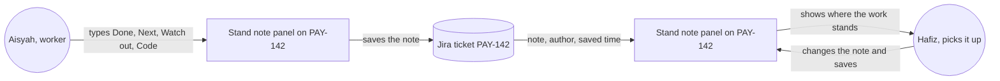

# Stand note

**Version:** v1 · **Status:** Draft · **Type:** Skeleton · **Project type:** Web UI

**Shape doc:** docs/specs/ticket-handover/shape.md
**Depends on:** None

A person saves a short note on a Jira ticket that says where the work stands, and
anyone who opens the ticket reads it. It ships first because it proves the Forge
rails, and each later slice reads or writes this note.

## Problem

When a ticket changes hands mid-flight, the person who picks it up can see what it
asks for but not where the work stands. They message someone who may not answer, or
they start over. Today the ticket has no place for that state: the team pastes a link
in the description or a comment when someone remembers.

## Slice test

| Check                         | Result                                                              |
| ----------------------------- | ------------------------------------------------------------------- |
| Cuts every layer it needs     | yes — panel on the ticket, save, data on the ticket, deployed on Forge |
| One e2e test walks it         | yes — save a note on a ticket, open the ticket again, read the note |
| Worth shipping alone          | yes — a team can keep a stand note by hand                          |
| Fits (≤5 scenarios, ≤2 areas) | yes — 5 scenarios, one area: the note panel                         |

**Path:** full — a new app on an empty repo, with a new interface.

## User story

As a developer who stops work on a ticket, I want to leave a short note of where the
work stands, so that a teammate carries on without a message to me.

## Flow



Aisyah saves a four-field note on the ticket, and Hafiz opens the same ticket later,
reads the note with its author and age, and saves his own changes.

## Acceptance criteria

```gherkin
Scenario: Save the first note
  Given ticket PAY-142 "Add refund endpoint" has no stand note
  And Aisyah Rahman can edit PAY-142
  When Aisyah opens PAY-142
  Then the panel says "No stand note yet"
  And Save is not available while all four fields are empty
  When she types Done "Endpoint and validation are written"
  And she types Next "Add the idempotency check"
  And she types Watch out "The sandbox rejects amounts over RM 5,000"
  And she types Code "feat/pay-142-refund"
  And she selects Save
  Then the panel shows the four fields as she typed them
  And the panel says "Saved by Aisyah Rahman, just now"

Scenario: Read the note on a ticket that changed hands
  Given Aisyah saved a stand note on PAY-142 on 2026-11-24 at 16:40
  When Hafiz Omar opens PAY-142 on 2026-11-26 at 09:15
  Then the panel shows Done, Next, Watch out and Code as Aisyah saved them
  And the panel says "Saved by Aisyah Rahman, 2 days ago"

Scenario: A new save replaces the note
  Given PAY-142 has the stand note that Aisyah saved
  And Hafiz Omar can edit PAY-142
  When Hafiz changes Done to "Endpoint, validation and idempotency check are written"
  And he changes Next to "Write the tests for partial refunds"
  And he selects Save
  Then the panel shows Hafiz's text in Done and Next
  And the panel says "Saved by Hafiz Omar, just now"
  And Aisyah's earlier text for Done and Next is gone

Scenario: A person who can only view the ticket reads the note
  Given PAY-142 has the stand note that Hafiz saved
  And Tan Mei Ling can view PAY-142 but cannot edit it
  When Mei Ling opens PAY-142
  Then the panel shows the four fields and "Saved by Hafiz Omar"
  And the panel has no Edit control and no Save control

Scenario: The save fails
  Given Aisyah typed Next "Add the idempotency check" on PAY-142
  When she selects Save and Jira does not accept the save
  Then the panel says "The note was not saved. Try again."
  And her text stays in the fields
  And the note on the ticket is the same as before
```

## Scope

**In:**

- A stand-note panel on the Jira ticket view.
- Four short free-text fields: Done, Next, Watch out, Code. Each holds up to 1,000
  characters. Each is optional, but a save needs text in one or more of them.
- One note for each ticket. A save replaces the note.
- The saved line: who saved the note, and how long ago.
- A person who can edit the ticket can save the note. A person who can view the
  ticket can read it.
- When two people save at the same moment, the later save wins, with no warning.
- The app runs on the developer Jira site, in the Forge development environment.
- Vitest unit tests, and one Playwright e2e test that walks the slice.

**Out:**

- A coding agent saves the note — `agent-checkpoint`.
- A warning that work moved after the note was saved — `at-risk-list`.
- A search for tickets by their note — `at-risk-list`.
- A production deploy and the install link for judges — `judge-ready-entry`.
- The history of earlier notes — no slice yet.
- A warning when two people edit at the same time — no slice yet.
- A control that clears the note — no slice yet.
- CI — not planned. The tests run by hand before each deploy.

## Stack

The developer chose each of these on 2026-11-20. This is the record for the project.

| Layer           | Choice                                                         |
| --------------- | -------------------------------------------------------------- |
| Host and deploy | Atlassian Forge, deployed with `forge deploy` from the laptop  |
| Language        | JavaScript                                                     |
| UI              | Forge UI Kit for the stand-note panel                          |
| Data            | A Jira issue property on each ticket                           |
| Package manager | npm                                                            |
| Unit tests      | Vitest                                                         |
| e2e tests       | Playwright on the real Jira site, with a login saved by hand   |
| CI              | None                                                           |
| Jira site       | A new free developer site, made with a personal Atlassian account |

## Decisions to record

These are drafts. They go into `DECISIONS.md` when pause 1 is approved.

## D2 · 2026-11-20 · Write the Forge app in JavaScript

Why: the Forge docs say "Forge apps are written in JavaScript", and each tutorial uses
it. This is the developer's first Forge app.
Rejected: TypeScript (the docs name a deploy error, TS2304, that needs a workaround).
Source: docs/specs/stand-note.md
Status: active

## D3 · 2026-11-20 · UI Kit for the stand-note panel

Why: the note form needs a form, four text fields and a button, and UI Kit has them
with the Jira look. The choice is per module, so a later screen can use Custom UI.
Rejected: Custom UI (more code, and it needs a design system of our own first).
Source: docs/specs/stand-note.md
Status: active

## D4 · 2026-11-20 · Keep the stand note as a Jira issue property

Why: Jira's own permissions decide who reads and writes the note, Jira deletes it with
the ticket, and Jira search can find tickets by it for the at-risk list.
Rejected: Forge key-value store (the app must check permissions itself, and the at-risk
list must join two sources), Forge SQL (a database for one note per ticket).
Source: docs/specs/stand-note.md
Status: active

## D5 · 2026-11-20 · npm as the package manager

Why: the Forge docs and the Forge CLI assume npm.
Rejected: pnpm (not tested with `forge deploy`), yarn (not tested with `forge deploy`).
Source: docs/specs/stand-note.md
Status: active

## D6 · 2026-11-20 · Vitest for unit tests, Playwright for e2e tests

Why: Forge has no official test tools. Playwright walks the real Jira site as a user
does, and Vitest runs the unit tests in seconds.
Rejected: Jest (slower than Vitest), a hand walk in place of Playwright (no automated
proof that the slice works).
Source: docs/specs/stand-note.md
Status: active

## D7 · 2026-11-20 · No CI

Why: one developer has 32 days, and the judges do not look at CI. The tests run by hand
before each deploy.
Rejected: GitHub Actions (setup time and a hosted repo, for no gain with the judges),
GitLab CI (the same).
Source: docs/specs/stand-note.md
Status: active

## Open items

| ID  | What | Type | Raised at | Owner | Status | Answer |
| --- | ---- | ---- | --------- | ----- | ------ | ------ |
| O1  | Playwright can drive the stand-note panel on the real Jira site, with a login session that the developer saved by hand. D6 and the e2e test rest on it. | unproven | spec p1 | poc | Open | — |
| O2  | Jira shows the panel by default to a person who can view a ticket but cannot edit it. The docs say that the issue panel module is added by hand and shows only to editors. They do not say for the issue context module. Scenario 4 rests on it. | unproven | spec p1 | poc | Open | — |
| O3  | Which fields does a stand note have? | question | spec p1 | user | Resolved | Done, Next, Watch out, Code. 2026-11-20 |
| O4  | Who can save or change the note? | question | spec p1 | user | Resolved | Anyone who can edit the ticket. Anyone who can view the ticket can read the note. 2026-11-20 |
| O5  | The Forge docs ask for Node 24.22.1 or later. The laptop has Node 24.18.1. | flag | spec p1 | poc | Open | — |

_Never delete this section or its rows. See references/ledger.md._

## Glossary

- **Forge** — Atlassian's platform for apps that run inside Jira and its other products.
- **UI Kit** — Forge's set of ready-made screen parts, such as forms and buttons.
- **Custom UI** — the other Forge way to build a screen: our own web page in a frame.
- **Module** — one place where a Forge app adds something to Jira, such as a panel on a ticket.
- **Jira issue property** — a small piece of data that an app attaches to one ticket.
- **Stand note** — the short note on a ticket that says where the work stands.
- **Walking skeleton** — the thinnest app that runs through each layer and is deployed.
- **e2e** — end to end. An e2e test uses the app as a user does.
- **Vitest** — a tool that runs unit tests for JavaScript.
- **Playwright** — a tool that drives a real browser from a test.
- **CI** — continuous integration: tests that run by themselves on each push.
- **Development environment** — the Forge copy of the app for work in progress. Forge also has staging and production.
- **`/poc`** — a short spike with throwaway code that answers one risky question.
- **Idempotency check** — a check that stops the same request from being done twice. It is example text in a scenario.
