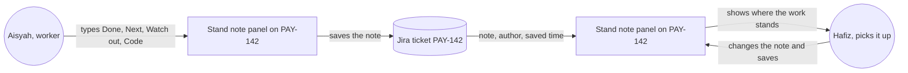

# Stand note

**Version:** v1 · **Status:** Draft · **Type:** Skeleton · **Project type:** Web UI

**Shape doc:** docs/specs/ticket-handover/shape.md
**Depends on:** None

A person saves a short note on a Jira ticket that says where the work stands, and
anyone who opens the ticket reads it. It ships first because it proves the Forge
rails, and each later slice reads or writes this note.

## Problem

When a ticket changes hands mid-flight, the person who picks it up can see what it
asks for but not where the work stands. They message someone who may not answer, or
they start over. Today the ticket has no place for that state: the team pastes a link
in the description or a comment when someone remembers.

## Slice test

| Check                         | Result                                                              |
| ----------------------------- | ------------------------------------------------------------------- |
| Cuts every layer it needs     | yes — panel on the ticket, save, data on the ticket, deployed on Forge |
| One e2e test walks it         | yes — save a note on a ticket, open the ticket again, read the note |
| Worth shipping alone          | yes — a team can keep a stand note by hand                          |
| Fits (≤5 scenarios, ≤2 areas) | yes — 5 scenarios, one area: the note panel                         |

**Path:** full — a new app on an empty repo, with a new interface.

## User story

As a developer who stops work on a ticket, I want to leave a short note of where the
work stands, so that a teammate carries on without a message to me.

## Flow



Aisyah saves a four-field note on the ticket, and Hafiz opens the same ticket later,
reads the note with its author and age, and saves his own changes.

## Acceptance criteria

```gherkin
Scenario: Save the first note
  Given ticket PAY-142 "Add refund endpoint" has no stand note
  And Aisyah Rahman can edit PAY-142
  When Aisyah opens PAY-142
  Then the Stand note header in the right column shows the tag "No note"
  When she expands Stand note
  Then the panel says "No stand note yet"
  And Save is not available while all four fields are empty
  When she types Done "Endpoint and validation are written"
  And she types Next "Add the idempotency check"
  And she types Watch out "The sandbox rejects amounts over RM 5,000"
  And she types Code "feat/pay-142-refund"
  And she selects Save
  Then the panel shows the four fields as she typed them
  And the panel says "Saved by Aisyah Rahman, just now"

Scenario: Read the note on a ticket that changed hands
  Given Aisyah saved a stand note on PAY-142 on 2026-11-24 at 16:40
  When Hafiz Omar opens PAY-142 on 2026-11-26 at 09:15
  Then the Stand note header shows the tag "2 days ago"
  When he expands Stand note
  Then the panel shows Done, Next, Watch out and Code as Aisyah saved them
  And the panel says "Saved by Aisyah Rahman, 2 days ago"

Scenario: A new save replaces the note
  Given PAY-142 has the stand note that Aisyah saved
  And Hafiz Omar can edit PAY-142
  When Hafiz expands Stand note
  And he changes Done to "Endpoint, validation and idempotency check are written"
  And he changes Next to "Write the tests for partial refunds"
  And he selects Save
  Then the panel shows Hafiz's text in Done and Next
  And the panel says "Saved by Hafiz Omar, just now"
  And Aisyah's earlier text for Done and Next is gone

Scenario: A person who can only view the ticket reads the note
  Given PAY-142 has the stand note that Hafiz saved
  And Tan Mei Ling can view PAY-142 but cannot edit it
  When Mei Ling opens PAY-142 and expands Stand note
  Then the panel shows the four fields and "Saved by Hafiz Omar"
  And the panel has no Edit control and no Save control

Scenario: The save fails
  Given Aisyah typed Next "Add the idempotency check" on PAY-142
  When she selects Save and Jira does not accept the save
  Then the panel says "The note was not saved. Try again."
  And her text stays in the fields
  And the note on the ticket is the same as before
```

## Scope

**In:**

- A Stand note panel in the right column of the Jira ticket view. It starts collapsed.
- A tag on the collapsed header: "No note", or the age of the note, such as "2 days ago".
- Four short free-text fields: Done, Next, Watch out, Code. Each holds up to 1,000
  characters. Each is optional, but a save needs text in one or more of them.
- One note for each ticket. A save replaces the note.
- The saved line: who saved the note, and how long ago.
- A person who can edit the ticket can save the note. A person who can view the
  ticket can read it.
- When two people save at the same moment, the later save wins, with no warning.
- The app runs on the developer Jira site, in the Forge development environment.
- Vitest unit tests, and one Playwright e2e test that walks the slice.

**Out:**

- A coding agent saves the note — `agent-checkpoint`.
- A warning that work moved after the note was saved — `at-risk-list`.
- A search for tickets by their note — `at-risk-list`.
- A production deploy and the install link for judges — `judge-ready-entry`.
- The history of earlier notes — no slice yet.
- A warning when two people edit at the same time — no slice yet.
- A control that clears the note — no slice yet.
- CI — not planned. The tests run by hand before each deploy.

## Stack

The developer chose each of these on 2026-11-20. This is the record for the project.

| Layer           | Choice                                                         |
| --------------- | -------------------------------------------------------------- |
| Host and deploy | Atlassian Forge, deployed with `forge deploy` from the laptop  |
| Language        | JavaScript                                                     |
| UI              | Forge UI Kit for the stand-note panel                          |
| Data            | A Jira issue property on each ticket                           |
| Package manager | npm                                                            |
| Unit tests      | Vitest                                                         |
| e2e tests       | Playwright on the real Jira site, with a login saved by hand   |
| CI              | None                                                           |
| Jira site       | `dzaffren.atlassian.net`, the developer's own site                |

### Spike findings, 2026-11-20

A throwaway hello-world app answered O1, O2 and O5. The spike code is deleted.

- `forge create -t jira-issue-context-ui-kit -s <developer space id> -y <name>` makes the app with no prompts.
  The developer space is `dzaffren-dev`.
- The template uses `@forge/react`, `@forge/bridge` and a resolver function, on runtime `nodejs24.x`.
- `forge deploy --non-interactive -e development`, then `forge install --non-interactive --site
  dzaffren.atlassian.net --product jira -e development --confirm-scopes`, puts the app on the site.
- The Forge CLI reads `FORGE_EMAIL` and `FORGE_API_TOKEN` from the environment. The token is in `.env`
  as `ATLASSIAN_API_KEY`. Git ignores `.env`.
- UI Kit renders in the main page, not in a frame. Playwright finds the panel header as a button with
  the module title in its name, and it finds the panel text with a plain text locator.
- The panel starts collapsed in each new browser session. A test must expand it first.
- Google refuses sign-in in Playwright's browser. The e2e account is a second Atlassian account with an
  email and a password. Its saved login is in `e2e/.auth/state.json`, which git ignores.
- A new account lands on a Jira welcome page until it picks a kind of work. The test account did that once.
- The site's "Default software scheme" lets each logged-in Jira user edit tickets. A view-only person
  exists only when the "any logged-in user" grant for Edit Issues is removed. The spike removed the grant
  through the Jira API, ran the test, and put the grant back.
- Only the test account can log in to Playwright. The main account can still act in a test through the
  Jira API with its token.
- `npm install -g @forge/cli` skipped the install scripts of `cloudflared` and `keytar`. `forge tunnel`
  may need them.

## Decisions to record

Pause 1: recorded as D2, D3, D4, D5, D6, D7 and D8.

## Open items

| ID  | What | Type | Raised at | Owner | Status | Answer |
| --- | ---- | ---- | --------- | ----- | ------ | ------ |
| O1  | Playwright can drive the stand-note panel on the real Jira site, with a login session that the developer saved by hand. D6 and the e2e test rest on it. | unproven | spec p1 | poc | Resolved | Yes, with a condition. A spike script opened PAY-1, expanded a hello-world panel and read the text from its backend call. The account must sign in with an email and a password: Google refuses sign-in in Playwright's browser. 2026-11-20 |
| O2  | Jira shows the panel by default to a person who can view a ticket but cannot edit it. The docs say that the issue panel module is added by hand and shows only to editors. They do not say for the issue context module. Scenario 4 rests on it. | unproven | spec p1 | poc | Resolved | Yes, for the issue context module. It shows on each ticket with no setup. The test account, with view permission and no edit permission on PAY-1, saw the panel and its content. The panel is last in the right column and starts collapsed. 2026-11-20 |
| O3  | Which fields does a stand note have? | question | spec p1 | user | Resolved | Done, Next, Watch out, Code. 2026-11-20 |
| O4  | Who can save or change the note? | question | spec p1 | user | Resolved | Anyone who can edit the ticket. Anyone who can view the ticket can read the note. 2026-11-20 |
| O5  | The Forge docs ask for Node 24.22.1 or later. The laptop has Node 24.18.1. | flag | spec p1 | poc | Resolved | Forge CLI 15.1.0 refuses Node below 24.22.1. Node 24.22.3 is installed through nvm, and the CLI runs on it. The repo gets an `.nvmrc` file in the build. 2026-11-20 |
| O6  | Where does the stand note sit on the ticket? The spike showed that the issue context spot is last in the right column and starts collapsed. | question | poc | user | Resolved | The right column, with a tag on the collapsed header that shows "No note" or the age of the note. Drafted as D8. 2026-11-20 |
| O7  | The tag shows on the collapsed header before a person expands the panel. The docs are not clear on when Jira asks the app for the tag. | unproven | poc | user | Accepted risk | The build finds out. If the tag does not show before the first expand, the header keeps a fixed label. Accepted 2026-11-20 |

_Never delete this section or its rows. See references/ledger.md._

## Glossary

- **Forge** — Atlassian's platform for apps that run inside Jira and its other products.
- **UI Kit** — Forge's set of ready-made screen parts, such as forms and buttons.
- **Custom UI** — the other Forge way to build a screen: our own web page in a frame.
- **Module** — one place where a Forge app adds something to Jira, such as a panel on a ticket.
- **Issue context** — the Forge module that adds a collapsible panel to the right column of a ticket.
- **Issue panel** — the Forge module that adds a panel to the main column of a ticket.
- **Tag** — the small coloured label on the collapsed panel header. Atlassian calls it a lozenge.
- **Jira issue property** — a small piece of data that an app attaches to one ticket.
- **Stand note** — the short note on a ticket that says where the work stands.
- **Walking skeleton** — the thinnest app that runs through each layer and is deployed.
- **e2e** — end to end. An e2e test uses the app as a user does.
- **Vitest** — a tool that runs unit tests for JavaScript.
- **Playwright** — a tool that drives a real browser from a test.
- **CI** — continuous integration: tests that run by themselves on each push.
- **Development environment** — the Forge copy of the app for work in progress. Forge also has staging and production.
- **`/poc`** — a short spike with throwaway code that answers one risky question.
- **Idempotency check** — a check that stops the same request from being done twice. It is example text in a scenario.
