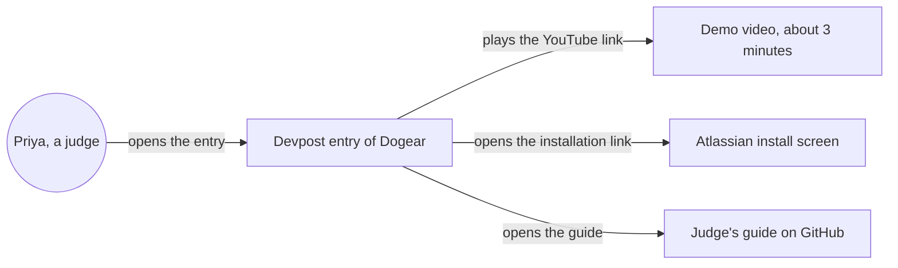
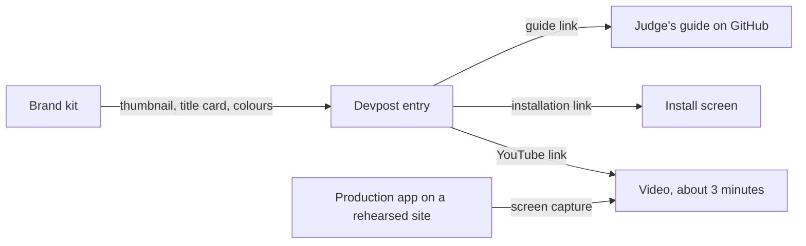

# Submit entry

**Version:** v1 · **Status:** Draft · **Type:** Feature · **Project type:** Web UI

**Shape doc:** docs/specs/ticket-handover/shape.md
**Depends on:** judge-ready-entry

The Dogear entry gets its demo video and its Devpost text, and Dzafran submits it. It ships
now because Codegeist 2026 closes on 2026-12-22 at 12:00 Pacific Time, which is 2026-12-23
at 04:00 in Malaysia.

## Problem

The entry has no video and no Devpost text. The judges score from 2027-01-05 to 2027-02-03,
and presentation is one of five criteria of equal weight. After the deadline, nothing
changes. `docs/specs/judge-ready-entry.md` › "What the official rules ask" lists the rules.

This spec split off from `judge-ready-entry` on 2026-11-23. Its scenarios and its Interface
were approved there, at pauses 1 and 2.

## Slice test

| Check                         | Result |
| ----------------------------- | ------ |
| Cuts every layer it needs     | yes — the script, the capture of the production app, the render, YouTube, and the Devpost form |
| One e2e test walks it         | yes — one run as a judge: open the Devpost entry with no sign-in, play the video, open each link |
| Worth shipping alone          | yes — without it, there is no entry |
| Fits (≤5 scenarios, ≤2 areas) | yes — 2 scenarios, two areas: the video, and the entry on Devpost |

**Path:** full — a video and a submission.

## User story

As a Codegeist judge, I want one page with a short video and each link, so that I
understand Dogear before I install it.

## Flow



Priya starts at the Devpost entry, plays the video, and goes on to the install and the
guide of `judge-ready-entry`.

## Acceptance criteria

```gherkin
Scenario: The demo video is public
  Given the demo video is on YouTube
  When a person with no YouTube sign-in opens the link from the Devpost entry
  Then the video plays, and it is shorter than 5 minutes
  And it shows the production app: a dogear in the panel, a coding agent with the two tools, the Dogears tab and a pick-up brief
  And it says what the problem is, who has it, and why it matters
  And it gives one figure from Atlassian's State of Developer Experience report, with the source on screen
  And it is in English, with no third-party trademark and no music under copyright

Scenario: The entry is submitted
  Given the Devpost form of Dogear has the category "Apps for Software Teams"
  And it names the bonus prize "Best app with Atlassian MCP"
  And it has the text description, the use of Forge and Jira, the write-up for the bonus prize, the installation link, the guide and the YouTube link
  When Dzafran selects Submit before 2026-12-22 at 12:00 Pacific Time
  Then Devpost shows Dogear as submitted to Codegeist 2026
```

## Scope

**In:**

- The text of the Devpost entry: the description, the use of Forge and Jira, the category,
  and the part for the bonus prize.
- The script of the demo video, and the video itself, from the screen-demo pipeline of
  OpenMontage. Dzafran puts the video on YouTube.
- One published figure for the pitch, with its source.
- Dzafran submits the entry on Devpost. Nothing goes to Devpost or YouTube without Dzafran.

**Out:**

- The production deploy, the installation link, the guide, the skill file and the icon —
  `judge-ready-entry`, which ships before this slice.
- A listing on the Atlassian Marketplace — not planned. D1 aims for one bonus prize.

## Interface

**Design system:** the brand kit of `dogear-brand`. `docs/design/logo/kit/guidelines.md`
gives the logo, the three colours and the typeface.

**Motion tier:** the motion of the video is planned in the `art-direction.md` of the
OpenMontage project, from the kit's colours and typeface.

**Preview:** none. The script of the video gets its own approval at the script stage of the
OpenMontage pipeline.



### The Devpost entry

The build writes these texts to `docs/entry/devpost.md`, for the usual fields of Devpost.
Nobody saw the form of Codegeist (O12), so the texts get fitted when Dzafran starts the
draft.

| Field | Text |
| ----- | ---- |
| Name | Dogear |
| Tagline | Mark where you stopped. |
| Short pitch | Dogear keeps a short, current note on each Jira ticket. People and their coding agents keep it, so a teammate picks the ticket up and carries on. |
| Thumbnail | `docs/design/logo/kit/png/devpost-thumbnail.png` |
| Gallery | Four screenshots from production: the panel with a dogear, the agent's terminal with the panel beside it, the Dogears tab, a pick-up brief. |
| Category | Apps for Software Teams |
| Bonus prize | Best app with Atlassian MCP |
| Links | The installation link, the guide, the repo, the YouTube video |
| Built with | Forge, UI Kit, Jira issue properties, the `rovo:mcp` module, Forge LLM, Jira REST API |

The story has these parts. Each one answers a criterion of the judges.

| Part | What it says | Criterion |
| ---- | ------------ | --------- |
| The problem | A ticket changes hands, and the next person starts from zero. The figure, with its source. Who has the problem: a team where people and coding agents share tickets. | Potential impact |
| What it does | The dogear in the panel. The two tools for a coding agent. The Dogears tab for a lead. The pick-up brief for a ticket with no dogear. | Design |
| How it uses Forge | Each Forge module and what it does. The dogear is an issue property, so the data stays in Jira. Each call to Jira runs as the person. | Technological implementation |
| What is new | An agent keeps the handover note as it works, and a second agent reads it. A status field and a comment thread do not do this. | Innovation |
| The MCP bonus | The `rovo:mcp` module with two tools. The tools act as the person. The panel says when an agent saved. The open-source skill file. | The bonus prize |
| How to test it | The steps of the guide, in short, with the link to the guide. | Stage one |

**The figure:** "50% of developers lose 10 or more hours a week to non-coding work, and
finding information is the top time-waster." Source: Atlassian, State of Developer
Experience 2025, a survey of 3,500 developers and managers. The 2026 report puts finding
information first again, with no figure for hours. Both posts were read on 2026-11-23:
https://www.atlassian.com/blog/bitbucket/developer-experience-report-2025 and
https://www.atlassian.com/blog/development/developer-experience-report-2026. The figure is
about lost time and finding information. It is not a count of handovers, and the pitch
does not say that it is.

### The video

About 3 minutes. The voice says "a coding agent", and the terminal shows no product name
(O7). The people in it are Aisyah Rahman and Hafiz Omar, the two test personas.

| Time | Beat | On screen |
| ---- | ---- | --------- |
| 0:00 to 0:25 | The problem. Aisyah is off sick, and Hafiz picks up her ticket with no idea where it stands. The figure. | Title card with the logo, then the figure with its source |
| 0:25 to 0:55 | The dogear. Aisyah saves Done, Next, Watch out and Code. Hafiz opens the ticket and reads it. | The Dogear panel |
| 0:55 to 1:45 | The coding agent. It reads the dogear, does one step, and saves. The panel says that an agent saved. A second agent carries on from Next. | A terminal, with the panel beside it |
| 1:45 to 2:10 | The lead. One tab lists each in-progress ticket with no dogear, or a dogear that is behind. | The Dogears tab |
| 2:10 to 2:40 | The pick-up brief. A ticket with no dogear gets a brief from what Jira has, and Hafiz saves it as the dogear. | The panel with a brief |
| 2:40 to 3:00 | How it is built, and where to get it. | The Forge modules as a short list, then the logo, the tagline and the link |

## Decisions to record

## D32 · 2026-11-23 · The pitch cites published surveys

Why: judges score a "credible, specific case", and a judge can open the source of a
published figure.
Rejected: a count from the developer's own team (one team's number, with no source that a
judge can check), no number (the case stays a story).
Source: docs/specs/judge-ready-entry.md
Status: active

## D35 · 2026-11-23 · The demo video comes from the screen-demo pipeline of OpenMontage

Why: the same pipeline made the videos of KinCart and Fire Watch, so its tools and its
steps are known. A change of the script needs a new render, not a new take.
Rejected: a screen recording with the developer's voice (each change needs a new take),
captions with no voice (judges score presentation at 20%).
Source: docs/specs/judge-ready-entry.md
Status: active

## Open items

| ID  | What | Type | Raised at | Owner | Status | Answer |
| --- | ---- | ---- | --------- | ----- | ------ | ------ |
| O1  | Which number does the pitch use? (from `judge-ready-entry` O1) | flag | spec p1 | user | Resolved | Published surveys. The figure in the video is from Atlassian's State of Developer Experience 2025, because the rules bar third-party trademarks in the video. The Interface gives the figure and its sources. Drafted as D32. 2026-11-23 |
| O2  | How is the demo video made? (from `judge-ready-entry` O4) | question | spec p1 | user | Resolved | The screen-demo pipeline of OpenMontage, as for KinCart and Fire Watch. Drafted as D35. 2026-11-23 |
| O3  | The rules bar third-party trademarks in the video, and the video shows Claude Code. (from `judge-ready-entry` O7) | flag | spec p1 | user | Resolved | Hide the brand. The video shows the agent's terminal with no product name and no logo, and the voice says "a coding agent". 2026-11-23 |
| O4  | Assuming the Devpost form of Codegeist has the usual Devpost fields. Nobody saw the form. (from `judge-ready-entry` O12) | assumption | spec p2 | user | Accepted risk | The build writes each text for the usual fields. When Dzafran starts the draft, Dzafran pastes the form's field list, and the build fits the texts then. A wrong guess costs a change of text. 2026-11-23 |
| O5  | How long is the video? (from `judge-ready-entry` O13) | question | spec p2 | user | Resolved | About 3 minutes, in six beats. 2026-11-23 |
| O6  | Both e2e accounts of `dzaffren.atlassian.net` have the same display name. The video names Aisyah Rahman and Hafiz Omar. Which names does the screen show, and on which site does the capture run? | question | spec p3 | user | Open | — |
| O7  | How does the video capture the coding agent's terminal with no product name: a recording of the real terminal, or a terminal drawn from the text of a real session? | question | spec p3 | user | Open | — |

_Never delete this section or its rows. See references/ledger.md._

## Glossary

- **Dogear** — the app. Also the short note on a ticket that says where the work stands.
- **Devpost** — the site that runs the hackathon and takes the entry.
- **Codegeist** — Atlassian's yearly hackathon for Forge apps.
- **OpenMontage** — the developer's tool that makes a video from a script, a screen capture and a voice.
- **Remotion** — a tool that builds a video from code.
- **Text-to-speech** — software that reads a text aloud.
- **Forge** — Atlassian's platform for apps that run inside Jira and its other products.
- **MCP** — Model Context Protocol, the standard way an AI agent calls outside tools.
- **Coding agent** — an AI tool that writes code for a developer, such as Claude Code.
- **Pick-up brief** — a short text that AI builds from a ticket's Jira data.
- **D1** — the first entry in `DECISIONS.md`.
