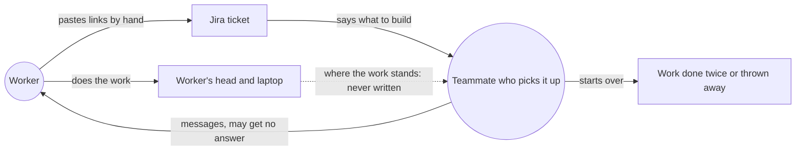
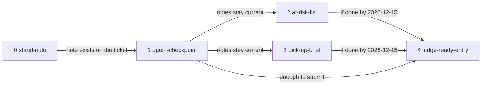

# Ticket handover

**Project type:** web UI (a Forge app inside Jira) · **Status:** Shaped

## Problem

When a ticket changes hands mid-flight, the person who picks it up can see what it
asks for but not where the work stands. They message someone who may not answer, or
they start over, so work is done twice or thrown away.

## Today

The ticket holds the request and a few pasted links to GitLab and SharePoint. The
progress lives with the worker, and it leaves with them on a sick day, on leave, or
when urgent work pulls them away.

Success test: a teammate is out sick with a ticket half done. Someone else picks it
up and carries on from where they stopped. They do not message the teammate, and they
do not start over.

## Hackathon limits

- Codegeist 2026. Entries close on 2026-12-22 at 12:00 Pacific Time.
- The entry is a Forge app that integrates with Jira. Category: Apps for Software Teams.
- Bonus prize target: Best app with Atlassian MCP (D1).
- Judges install the app on their own Jira site. They do not have GitLab or SharePoint.
- The entry needs an install link, setup instructions, a text description, and a
  public YouTube video under 5 minutes.
- One developer builds it, for more than 20 hours each week. This is their first Forge app.

## Slices

| # | Slice | What ships | Why this order |
|---|-------|-----------|----------------|
| 0 | stand-note | A worker saves a short note on a Jira ticket: done, next, watch out. Anyone who opens the ticket reads it, with its age and author. The app runs on a real Jira site, with one e2e test. | Walking skeleton. It proves the Forge rails, and each later slice reads or writes this note. |
| 1 | agent-checkpoint | A coding agent such as Claude Code saves the note through MCP as it works. A second agent reads the note and carries on. | It removes the reason notes go missing: nobody has to stop and write one. It qualifies for the MCP bonus prize. After this slice, the entry is enough to submit. |
| 2 | at-risk-list | A lead opens one page and sees each in-progress ticket with no note, or with a note older than the last work on the ticket. | Optional. A rule that tells an agent to comment cannot do this part, so it carries the innovation score. |
| 3 | pick-up-brief | A person opens a ticket with no note and gets a brief built from what Jira has: history, comments, links. The brief marks what is not known. | Optional. It serves people with no coding agent. It rests on the least proven technology, so it comes last of the build slices. |
| 4 | judge-ready-entry | A judge installs from the link, follows the guide, and sees a worked example in two minutes. The video and the Devpost form are submitted. | Required. Start it no later than 2026-12-15, in whatever state slices 2 and 3 are. |

## Not doing

- **GitLab and SharePoint integration.** Judges do not have them. Links to them stay
  links in the ticket.
- **Test cases from feature tickets.** Five or more Marketplace apps do this already.
- **Plain-words explanation of documents for product owners.** Rovo Chat does this already.
- **Ownership transfer when a person leaves** (filters, dashboards, assigned tickets).
  Marketplace offboarding apps do this already.
- **A check that documentation is complete.** Each team defines "complete" differently.
- **Rovo agent, Teamwork Graph and Marketplace bonus prizes.** One entry wins one bonus
  prize (D1).

## Open items

| ID | What | Type | Raised at | Owner | Status | Answer |
| -- | ---- | ---- | --------- | ----- | ------ | ------ |
| O1 | How many hours each week until the deadline? | question | shape | user | Resolved | More than 20 hours each week. All five slices are planned. 2026-11-20 |
| O2 | Has the developer built a Forge app before? | question | shape | user | Resolved | Never. Slice 0 stays small so that setup problems show early. 2026-11-20 |
| O3 | Which bonus prize does the entry aim for? | question | shape | user | Resolved | Atlassian MCP. Recorded as D1. 2026-11-20 |
| O4 | Which category does the entry go in? | question | shape | user | Resolved | Apps for Software Teams. 2026-11-20 |
| O5 | An outside agent such as Claude Code can call this app's tools through the Atlassian MCP server and save a note on a ticket. The `rovo:mcp` module is in Preview. Atlassian's docs say an admin can turn on outside access. One community post says the Preview serves only Rovo agents. | unproven | shape | poc | Handed to agent-checkpoint | Run `/poc` at the start of that spec. If outside agents cannot reach the app, the agent writes through the built-in Atlassian MCP tools and the app reads the result. 2026-11-20 |
| O6 | A team can get part of this with no app: a rule that tells the agent to post a progress comment through the built-in Atlassian MCP tools. Judges score innovation. | flag | shape | user | Accepted risk | The app adds one current note in place of a comment stream, a panel for people with no agent, and the at-risk list. Accepted 2026-11-20 |
| O7 | The pitch has no number for how often a ticket changes hands or what a bad handover costs. Judges score a "credible, specific case". | flag | shape | user | Handed to judge-ready-entry | Find published statistics and cite them in the video. 2026-11-20 |
| O8 | The pick-up brief needs generated text. Forge LLM calls cost money, and Codegeist gives no credits. Rovo may do the job at no cost on a free developer site. | unproven | shape | poc | Handed to pick-up-brief | — |

## Glossary

- **Forge** — Atlassian's platform for apps that run inside Jira and its other products.
- **MCP** — Model Context Protocol, the standard way an AI agent calls outside tools.
- **Atlassian MCP server** — the server that gives an agent tools for Jira and other Atlassian products.
- **`rovo:mcp`** — the Forge module that publishes an app's own tools on the Atlassian MCP server.
- **Rovo** — Atlassian's AI assistant and agents inside its products.
- **Preview** — a feature released for trial; its behaviour can change.
- **Coding agent** — an AI tool that writes code for a developer, such as Claude Code.
- **Stand note** — the short note on a ticket that says where the work stands: done, next, watch out.
- **Walking skeleton** — the thinnest app that runs through each layer and is deployed.
- **e2e** — end to end. An e2e test uses the app as a user does.
- **Devpost** — the site that runs the hackathon and takes the entry.
- **D1** — the first entry in `DECISIONS.md`.
